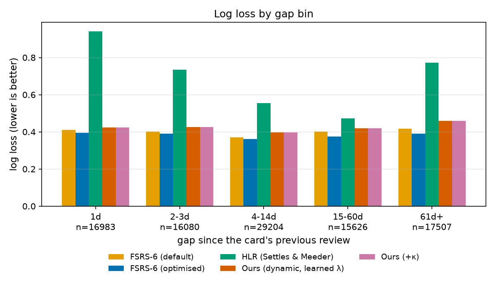
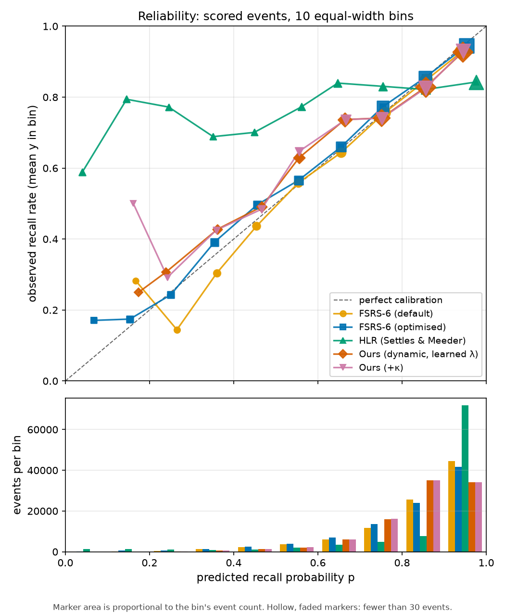

# Evaluation protocol: FSRS-6 vs our dynamic retention model vs HLR

## 1. Goal and summary

We compare five recall predictors on the same held-out review events:

| Key | Name in tables | What it is |
|---|---|---|
| `fsrs_default` | FSRS-6 (default) | py-fsrs 6.3.2 with its default 21 weights |
| `fsrs_opt` | FSRS-6 (optimised) | py-fsrs Optimizer fitted per user on training reviews |
| `hlr` | HLR (Settles & Meeder) | Half-life regression, trained as in the official code |
| `ours` | Ours (dynamic, learned λ) | `DynamicRetentionModelDT` (Bayesian, Gibbs sampling) |
| `ours_kappa` | Ours (+κ) | the same model with `use_kappa=True` |

Data: the `open-spaced-repetition/anki-revlogs-10k` review logs (Section 2). Metrics: log loss, Brier score, AUC, expected calibration error (ECE), mean bias and RMSE over bins (the overall table in `report.md` shows all of them; its per-gap tables omit RMSE, which `metrics.csv` has), with user-clustered bootstrap confidence intervals on paired differences (Section 6).

This document describes the protocol and the code. The numerical results are in Section 9.

### 1.1 Glossary

- **Rating.** Anki's answer buttons: 1 = Again (failed), 2 = Hard, 3 = Good, 4 = Easy. Recall (`y = 1`) means rating 2, 3 or 4.
- **Gibbs sampling.** An MCMC method that updates each latent variable in turn from its conditional distribution. Here the sampler alternates between the latent memory states, the hyper-parameters and the per-user and per-card effects.
- **Pólya-Gamma augmentation.** A data-augmentation trick that makes a logistic likelihood conditionally Gaussian, so the latent states can be sampled exactly.
- **FFBS.** Forward-filtering backward-sampling: draws a whole latent trajectory of a sequence from its exact conditional distribution, in one forward and one backward pass.
- **κ (kappa).** In `ours_kappa`, the decay rate is `λ · (1 + n)^(-κ)`, where `n` is the number of earlier correct recalls of the card (the model's covariate is `log(1 + n)`). With `use_kappa=False`, κ is fixed at 0.
- **λ (lambda).** The base decay rate of the model's memory, learned from data.
- **Posterior draws.** Samples of the model's parameters and latent states from the posterior, after burn-in and thinning. `predict()` uses a subset of them (at most 100).
- **Cold path.** The prediction rule the model uses for a user or card with no TRAIN history, which has no fitted per-user or per-card effect.
- **Split R-hat.** The Gelman-Rubin statistic computed on the two halves of one chain. Values near 1 indicate that the two halves agree. It is not a check between separate chains.
- **ESS.** Effective sample size: the number of independent-equivalent draws in an autocorrelated chain.

### 1.2 References

- Settles, B. and Meeder, B. (2016). A Trainable Spaced Repetition Model for Language Learning. ACL 2016.
- Duolingo. halflife-regression (MIT licence), `experiment.py`. https://github.com/duolingo/halflife-regression
- open-spaced-repetition. py-fsrs 6.3.2 (FSRS-6 scheduler and optimiser). https://github.com/open-spaced-repetition/py-fsrs
- open-spaced-repetition. anki-revlogs-10k dataset (gated). https://huggingface.co/datasets/open-spaced-repetition/anki-revlogs-10k
- Polson, N. G., Scott, J. G. and Windle, J. (2013). Bayesian inference for logistic models using Pólya-Gamma latent variables. JASA.
- Carter, C. K. and Kohn, R. (1994). On Gibbs sampling for state space models. Biometrika.

## 2. Dataset and sampling

- **Source.** Hugging Face dataset `open-spaced-repetition/anki-revlogs-10k`. It is gated: the user needs a Hugging Face token and must accept the dataset licence on its page.
- **Files used.** One parquet file per user, `revlogs/user_id=<u>/data.parquet`. The loader requires the columns `card_id`, `day_offset`, `rating`, `state` and `elapsed_days`, and uses `elapsed_seconds` for `dt_days` when that column is present. Other columns in the file are ignored.
- **User sampling.** `download_users(n_users, seed, out_dir)` takes the sorted list of user ids in the repository and draws `n_users` of them with `numpy.random.default_rng(seed)`, without replacement. `out_dir` is the data directory (`data/anki10k` by default). The sorted id list is cached in `<out_dir>/user_ids.json` on the first successful listing; later runs read the cache, so no network call is needed once the files exist. Files already on disk are not downloaded again.
- **Card cap.** `make_split(max_cards, seed)` keeps at most `max_cards` cards per user, sampled with `default_rng(seed)` from the sorted card ids. Cards not chosen are dropped entirely, so each card keeps its full history. The same cards go to every model. The cap is needed because the Gibbs sampler's cost grows with the number of cards and their sequence lengths. The full run uses `max_cards = 1000`. The timing study on 5 users (`--iters 200 --burn 100`) gave a total run time of 184 s at `max_cards = 300` and 340 s at `max_cards = 1000`. At 300 cards, one of the five users fell back to default FSRS weights; at 1000 cards, none did. That is why 1000 was chosen.

## 3. Event definition

One row of a user's revlog is one review. Rows keep their file order, which is chronological within a user. The rules, from `fsrs_benchmark/data.py` (`load_user`):

1. **Drop `rating == 0`.** These are manual reschedules, not recall attempts.
2. **Keep `state == 4`.** These rows are filtered-deck reviews and carry real ratings (1-4) and real durations. An earlier version dropped them, and FSRS then saw wrong gaps: one example had a gap of 515 days where the real gap was 1 day.
3. **Drop cards whose first kept review is not `state == 0` (new).** Their earlier history is truncated, so the memory state of the card cannot be rebuilt.
4. **Label.** `y = 1` if `rating > 1` (Hard, Good or Easy), else `0`.
5. **Gaps are recomputed over kept rows only,** so every model sees the same gap.
   - `elapsed_days`: the `day_offset` difference to the card's previous kept review. It is -1 on a first review. The file's own value is kept as `raw_elapsed_days`.
   - `dt_days`: the sum of raw `elapsed_seconds` since the previous kept row, divided by 86400. This includes the seconds of any dropped rows in between. It falls back to `elapsed_days` if any of those seconds are missing. It is NaN on a first review.
6. `is_first` marks the first kept review of each card. `review_idx` is the position within the user, and `event_id = user_id * 10^9 + review_idx` is unique.

## 4. Split and leakage guarantees

**Split.** `make_split` applies the card cap first, then computes a per-user cutoff: `cutoff_day` is the 80th percentile (linear interpolation) of `day_offset` over that user's kept reviews. A review is TRAIN if `day_offset < cutoff_day`, and TEST otherwise. Model parameters are fitted on TRAIN rows only.

**Scored events.** A TEST event is scored when it is not a card's first review and `elapsed_days >= 1`. This is the srs-benchmark convention of scoring inter-day reviews. Same-day reviews and first reviews are still fed to the models as history, but they are never scored.

**Prediction is one-step-ahead.** To predict scored event k, a model may use all history of that card before k: its TRAIN reviews and any earlier TEST reviews, including their outcomes. It may not use event k or anything after it. Fitted parameters are frozen during the test period.

**Tests that enforce this** (all under `fsrs_benchmark/tests/`):

| Guarantee | Test |
|---|---|
| No train event at or after the cutoff; cutoff is the 80th percentile; scored rule; card cap applied before the cutoff; determinism; unique event ids | `test_split.py`: `test_train_is_strictly_before_cutoff_per_user`, `test_cutoff_is_80th_percentile_of_kept_reviews`, `test_scored_rules`, `test_card_cap_applied_before_cutoff`, `test_deterministic_for_fixed_seed_and_seed_changes_cards`, `test_event_id_unique_int64_and_sorted` |
| Own and later outcomes never change a prediction | `test_fsrs_model.py`: `test_prediction_ignores_own_and_later_ratings`; `test_ours.py`: `test_prediction_ignores_own_and_later_outcomes`; `test_hlr.py`: `test_prediction_ignores_own_and_later_outcomes`; `test_ours_verify.py`: `test_own_and_later_outcomes_do_not_move_p` |
| Fit ignores test rows (including their gaps) | `test_fsrs_model.py` and `test_hlr.py`: `test_fit_ignores_test_rows`; `test_hlr_verify.py`: `test_fit_ignores_test_rows_including_their_gaps`; `test_run_verify.py`: `test_fit_does_not_see_test_labels` (flips every TEST label and checks that all five models give identical predictions) |
| Ids for `ours` come from TRAIN rows only; unseen users and cards take the cold path | `test_ours.py`: `test_unseen_user_and_card_take_the_cold_path`; `test_ours_verify.py`: `test_fit_and_predict_ids_agree_for_train_cards` |
| Real-data fit sends only TRAIN rows to the optimiser | `test_fsrs_model_verify.py`: `test_fit_on_real_users_sends_only_train_rows` |

## 5. Models

### 5.1 FSRS-6 (py-fsrs 6.3.2), both variants

- **Replay.** For each card, reviews are replayed in `review_idx` order through py-fsrs' `Scheduler` with `enable_fuzzing=False`. Review times are synthetic: a fixed UTC epoch plus `day_offset` days, plus the position of the review within its card in seconds. The seconds keep the order strict and keep same-day reviews distinct. py-fsrs measures gaps in whole days, so the gap it sees equals the `day_offset` difference.
- **Prediction.** Before a scored event is applied, its retrievability is read with py-fsrs' `get_card_retrievability`. That value is the prediction. The card's memory state is then updated with the event's own rating.
- **Default variant.** `optimize=False` uses py-fsrs' default parameters for everyone.
- **Optimised variant.** `optimize=True` runs py-fsrs' `Optimizer` per user on that user's TRAIN reviews only. Two py-fsrs limits apply:
  - the Optimizer trains on the first 64 reviews of each card (`max_seq_len = 64`);
  - py-fsrs returns the default weights, without a warning, when a user has fewer than 512 informative train reviews. We apply the same rule up front (`MIN_INFORMATIVE_TRAIN = 512`, counting non-same-day reviews) so the fallback is recorded, and we also record any user whose optimiser returned the defaults. Fallback users and reasons are in `run_info.json`.
- **Parallel fit.** `FSRSModel(n_workers > 1)` runs the per-user optimisations in a spawn-context process pool. Workers set torch to one thread. Each user is independent, and a test checks that parameters and predictions match the serial fit.

### 5.2 HLR (Settles & Meeder 2016), written from the official code

- **Model.** `p = 2^(-dt/h)` with `h = 2^(theta · x)`, where `x = [sqrt(1 + n_right), sqrt(1 + n_wrong), 1]` counts the card's PRIOR kept reviews of that user. Same-day and first reviews count as history.
- **Training.** A port of `HalfLifeRegression.train_update` in `duolingo/halflife-regression` `experiment.py` (MIT): SGD with the paper's loss (squared error on p plus `hlwt` times squared error on h, with L2 on the weights). Constants: `lrate = 0.001`, `hlwt = 0.01`, `l2wt = 0.1`, `sigma = 1`, `h` clipped to [15 min, 274 days], `p` clipped to [1e-4, 1 - 1e-4]. Per-feature learning rates and the recall-halving rule are as in the official code. The SGD step is checked against the official arithmetic to 1e-12.
- **Deviations** (documented in `hlr.py`):
  - The official code has per-lexeme indicator features. These are not in the Anki data, so they are not used.
  - The official code makes one shuffled pass. We repeat seeded shuffled passes until the largest weight change in one pass is below 1e-4, with at most 1000 passes. The number of passes is recorded as `epochs` in `run_info.json`. If it equals 1000, the fit did not converge.
- **Training rows.** TRAIN, non-first, `elapsed_days >= 1` rows.

### 5.3 Ours: `DynamicRetentionModelDT`, with and without κ

- **Code.** The unmodified `AnkiFirstRun/dynamic_retention_dt.py` is imported through an adapter (`fsrs_benchmark/models/ours.py`). Nothing in that file was changed.
- **Sequences.** One sequence per (user, card), built from TRAIN rows only in `review_idx` order. `r` is the outcome, `x` is the lagged outcome with `x[0] = 0`, `dt` is `dt_days` with NaN replaced by 1.0.
- **Ids.** User and card ids are remapped to dense integers from TRAIN rows only. A user or card with no TRAIN rows maps to the padding index, so the model's cold path applies to it.
- **Sampler.** `run(n_iter=iters, burn_in=burn, thin=4)` with `iters` and `burn` set by the run (defaults 2000 and 1000 in the CLI; the full run's values are in `run_info.json`). The posterior is sampled by Gibbs sweeps with forward-filter backward-sampling (FFBS) steps in the model file.
- **Prediction.** `predict()` runs the model's own one-step filtered prediction on the TEST sequences. Each card's TEST events are in order, and history events stay in the sequence. Predictions come from the posterior draws the model selects in `predict()` (at most `max_draws = 100`, evenly spaced over the saved chain). Only scored rows are kept.
- **Variant.** `ours_kappa` is the same model with `use_kappa=True`.

## 6. Metrics

All metrics are written from scratch in `fsrs_benchmark/metrics.py`. y is 0 or 1, and p is the predicted recall probability. N is the number of scored events.

| Metric | Definition |
|---|---|
| Log loss | `-(1/N) Σ [y log p + (1-y) log(1-p)]`, with p clipped to [1e-6, 1 - 1e-6] |
| Brier | `(1/N) Σ (p - y)²` |
| AUC | Rank-based (Mann-Whitney): the probability that a random positive event gets a higher p than a random negative one, with ties counted as one half |
| ECE | Ten equal-width bins on p: `Σ_b (n_b / N) · |mean p_b - mean y_b|` |
| Mean bias | `mean(p) - mean(y)`. Positive means too optimistic |
| RMSE (bins) | Twenty equal-width bins: `sqrt( Σ_b (n_b / N) · (mean p_b - mean y_b)² )` |
| Reliability curve | Per bin: `mean p_b` against `mean y_b`, with the bin counts |

**Gap bins.** Scored events are grouped by `elapsed_days` (whole days, integer edges): `1d`, `2-3d`, `4-14d`, `15-60d`, `61d+`. Because scored events have `elapsed_days >= 1`, the first bin is exactly one day.

**Paired differences.** For a model m and reference r, `diff = metric(m) - metric(r)`. Users are resampled with replacement (1000 resamples, seed 0). Each resample takes all events of the drawn users, and both models are resampled with the same users. The 95% CI is the 2.5 and 97.5 percentiles of the bootstrap differences. Reference models are `fsrs_opt` and `ours`. Metrics are log loss, Brier, AUC and ECE.

**Why cluster by user.** Reviews from one person are correlated (the same memory habits and the same schedule). Resampling single events would treat them as independent and give intervals that are too narrow. Resampling users keeps that correlation.

## 7. Reproducibility

**Environment.**

```
uv venv .venv --python 3.12
uv pip install --python .venv/bin/python numpy pandas pyarrow numba scipy matplotlib pytest huggingface_hub "fsrs[optimizer]==6.3.2"
```

The optimiser extra pulls in torch (CPU build is enough). Exact versions used for a run are in its `run_info.json`.

**Data access.** Log in with `huggingface-cli login` (or set `HF_TOKEN`), and accept the licence of `open-spaced-repetition/anki-revlogs-10k` on its Hugging Face page.

**Run.**

```
.venv/bin/python -m fsrs_benchmark.run --run_name <name> --n_users 100 --max_cards 1000 --seed 0 --iters 2000 --burn 1000 --workers 8
```

`--models` selects a subset (keys in Section 1). `--resume` reuses finished per-model predictions. Each `pred_<model>.parquet` has a `pred_<model>.json` sidecar with the config it came from: `n_users`, `max_cards`, `seed`, the SHA-256 of the scored event ids, and `iters` and `burn` for the `ours` models. A resumed run refuses any file whose sidecar differs from the current config, and says to delete the file or drop `--resume`.

**Report.**

```
.venv/bin/python -m fsrs_benchmark.report --run_dir results/<name>
.venv/bin/python -m fsrs_benchmark.supplementary --run_dir results/<name>
```

The second command writes `supplementary.json` (the FSRS-opt fallback count, the `ours` vs `ours_kappa` correlation and the `ours` reliability bins). It is recomputed from `events.parquet` and `predictions.parquet`, so it needs the local-only parquet files. Its output for `full_u100_c1000` matches the committed `supplementary.json`, and `fsrs_benchmark/tests/test_supplementary.py` checks that.

**Tests.** `.venv/bin/python -m pytest fsrs_benchmark/tests -q`. Tests that need the real revlogs (`data/anki10k/revlogs/user_id=...`) skip themselves if those files are missing.

**Outputs.** Each run folder `results/<name>/` contains:
- `events.parquet` (the full event table), `pred_<model>.parquet` and `.json`, `predictions.parquet` (scored rows only);
- `diagnostics_ours.json`, `diagnostics_ours_kappa.json`: MCMC summaries for the two `ours` variants, written only when those models are fitted (not on `--resume`);
- `run_info.json`: all arguments; git commit hash and a dirty flag; package versions (fsrs, numpy, pandas, torch, numba, Python); counts (users, cards, events, train, test, scored); users with zero train rows; FSRS-opt fallback count and user ids; HLR epochs; per-model fit and predict seconds; total seconds;
- from the report step: `metrics.csv`, `paired.csv`, `users.csv`, `user_wins.csv`, `reliability.png`, `gapbins_logloss.png`, `report.md`;
- from the supplementary step: `supplementary.json`.

For the full run `full_u100_c1000`, `run_info.json` has no FSRS-opt fallback fields and no HLR epochs, because those models were reused with `--resume` and not refitted. Section 9.7 gives the fallback count recomputed from the rule.

**Determinism.** The user sample, the card sample, the HLR shuffles and the `ours` sampler all take fixed seeds (`--seed`, default 0). The FSRS optimiser was checked to give the same parameters serially and in parallel.

**Runtime.** Fit and predict times per model are in `run_info.json`. Timing study on 5 users with `--iters 200 --burn 100`: total 184 s at `max_cards = 300` and 340 s at `max_cards = 1000`. On those 5 users, per-model fit times at 1000 cards were about 200 s for `fsrs_opt` with serial fitting and 115 s with `--workers 8`, and 49 s and 44 s for the two `ours` variants. The machine was shared with other jobs, so these are indicative. These numbers are for 5 users. The full 100-user run took much longer; its timings are in Section 9.6.

## 8. Limitations

- **Subsample.** The benchmark uses `--n_users` users (100 in the full run), with at most `max_cards` cards each (1000 in the full run). Results should not be compared directly with published numbers from other protocols.
- **FSRS pipeline.** FSRS-6 is run through py-fsrs 6.3.2 in Python, not through the srs-benchmark pipeline. Its data handling and split differ: the protocol here uses the per-user time cutoff above, not srs-benchmark's 5-fold TimeSeriesSplit, and it does not apply srs-benchmark's outlier filtering. The optimiser's limits (first 64 reviews per card, 512 informative reviews per user) apply.
- **HLR.** The model lacks the per-lexeme features of the original implementation. The comparison is with this simplified HLR.
- **MCMC convergence: not converged in the full run.** At 2000 iterations (1000 burn-in), the lambda R-hat is about 2.4 and its ESS about 3, against a target of R-hat below 1.01 and ESS in the hundreds (Section 9.8). The `ours` scores are therefore provisional. A longer run with several chains is future work.
- **Single seed and single chain.** The full run uses seed 0 only, and one MCMC chain per `ours` variant. There is no spread across seeds or chains to report, so the paired intervals above reflect only user sampling in the bootstrap, not run-to-run variation.
- **MCMC detail.** The `ours` models are sampled from a single MCMC chain per fit. Each run reports, per variant, the posterior mean, 95% interval, effective sample size (ESS) and split R-hat for the hyper-parameters (`diagnostics_ours.json`, `diagnostics_ours_kappa.json`, rendered in the report's "MCMC diagnostics" section). Split R-hat on one chain can detect within-chain drift but not disagreement between chains. Multiple chains are not run. Lambda acceptance is recorded for every sweep, but kappa acceptance is not exposed by the sampler, so it is not reported. ESS and R-hat are NaN or unreliable when the chain is very short (the smoke runs).
- **Scored events.** Same-day reviews and first reviews are never scored, so the results say nothing about them.
- **Bootstrap precision.** Cluster bootstrap intervals are only meaningful with many users. With a handful of users the intervals are wide or degenerate.
- **Event definition.** Cards whose first kept review is not new are dropped, and so are rating-0 rows. Results describe the cards that remain, not the whole collection.

## 9. Results

### 9.1 Run configuration

Run name `full_u100_c1000`: 100 users sampled with seed 0, at most 1000 cards per user, 2000 Gibbs iterations with 1000 burn-in for the two `ours` variants. The command is the one in [Section 7](#7-reproducibility).

| Quantity | Value |
|---|---|
| Users | 100 |
| Cards | 99,074 |
| Review events (all) | 768,658 |
| Train events | 606,364 |
| Test events | 162,294 |
| Scored events | 95,400 |
| Recall rate on scored events | 0.831 |

Git commit `0b6259e` with uncommitted changes (`dirty: true`), so the exact code state is not fully pinned.

### 9.2 Overall results

All five models are scored on the same 95,400 events. Best value in each column is in bold. Lower is better for log loss, Brier, ECE and RMSE; higher is better for AUC; for mean bias, closest to zero is best.

| Model | Log loss | Brier | AUC | ECE | RMSE (bins) | Mean bias |
|---|---|---|---|---|---|---|
| FSRS-6 (default) | 0.396 | 0.121 | 0.745 | 0.012 | 0.017 | 0.011 |
| FSRS-6 (optimised) | **0.379** | **0.117** | **0.777** | **0.009** | **0.014** | **-0.002** |
| HLR (Settles & Meeder) | 0.680 | 0.170 | 0.555 | 0.146 | 0.176 | 0.060 |
| Ours (dynamic, learned λ) | 0.422 | 0.131 | 0.692 | 0.025 | 0.032 | 0.011 |
| Ours (+κ) | 0.422 | 0.131 | 0.693 | 0.026 | 0.032 | 0.011 |

FSRS-6 (optimised) is best on every overall metric. Our model is clearly better than HLR on every metric, but worse than both FSRS-6 variants.

### 9.3 Results by gap

The gap is the number of days since the same card was last reviewed. Each bin has the same events for every model, so the recall rate is the same across models within a row.

Log loss by gap bin (lower is better):

| Gap | n | FSRS-6 (default) | FSRS-6 (optimised) | HLR | Ours | Ours (+κ) |
|---|---|---|---|---|---|---|
| 1d | 16,983 | 0.409 | **0.396** | 0.942 | 0.423 | 0.423 |
| 2-3d | 16,080 | 0.402 | **0.389** | 0.734 | 0.426 | 0.426 |
| 4-14d | 29,204 | 0.369 | **0.361** | 0.555 | 0.398 | 0.398 |
| 15-60d | 15,626 | 0.401 | **0.374** | 0.473 | 0.419 | 0.419 |
| 61d+ | 17,507 | 0.418 | **0.389** | 0.771 | 0.460 | 0.460 |

AUC by gap bin (higher is better):

| Gap | FSRS-6 (default) | FSRS-6 (optimised) | HLR | Ours | Ours (+κ) |
|---|---|---|---|---|---|
| 1d | 0.748 | **0.769** | 0.658 | 0.708 | 0.708 |
| 2-3d | 0.730 | **0.755** | 0.637 | 0.676 | 0.677 |
| 4-14d | 0.737 | **0.760** | 0.616 | 0.680 | 0.681 |
| 15-60d | 0.725 | **0.781** | 0.599 | 0.703 | 0.705 |
| 61d+ | 0.771 | **0.817** | 0.628 | 0.763 | 0.764 |



The ordering of the models does not change across gap bins: FSRS-6 (optimised) is best, then FSRS-6 (default), then our model, then HLR, on both log loss and AUC. Our model's log-loss gap to FSRS-6 (optimised) is widest at 61d+ (0.460 against 0.389), and its AUC gap is narrowest there (0.763 against 0.817).

### 9.4 Calibration



The curve pools all gaps, with 10 equal-width bins on the predicted recall. The FSRS-6 variants lie close to the diagonal, with FSRS-6 (default) somewhat below it in the middle bins. Our model sits clearly above it in the middle bins. In the 0.5 to 0.6 bin it predicts 0.555 on average, and 0.629 is observed (`supplementary.json`). HLR's pooled curve is far from the diagonal across the low and middle bins. The per-gap bias numbers show its direction more clearly. Split by gap, HLR over-predicts at short gaps (mean bias +0.170 at 1d) and under-predicts at 61d+ (mean bias -0.249). Our model over-predicts at 61d+ (mean bias +0.090), while at 1d its bias is -0.006.

### 9.5 Paired differences and user wins

Each difference is model minus reference, computed on the same events. The 95% CI comes from a user-clustered paired bootstrap (1000 resamples of users, seed 0). An asterisk marks a CI that excludes zero.

| Comparison | Log loss diff [95% CI] | Brier diff [95% CI] | AUC diff [95% CI] |
|---|---|---|---|
| FSRS-6 (default) - FSRS-6 (optimised) | 0.017 [0.008, 0.025] * | 0.004 [0.002, 0.006] * | -0.032 [-0.047, -0.016] * |
| Ours - FSRS-6 (optimised) | 0.043 [0.033, 0.055] * | 0.014 [0.011, 0.019] * | -0.084 [-0.110, -0.064] * |
| FSRS-6 (default) - Ours | -0.026 [-0.042, -0.013] * | -0.011 [-0.015, -0.007] * | 0.053 [0.023, 0.087] * |
| Ours (+κ) - Ours | -0.000 [-0.001, 0.000] | -0.000 [-0.000, 0.000] | 0.001 [-0.000, 0.002] |

Our model has a higher (worse) log loss than FSRS-6 (optimised) by 0.043, and a higher log loss than FSRS-6 (default) by 0.026. Both paired CIs exclude zero. Our model's ECE is higher than FSRS-6 (optimised) by 0.016 [0.001, 0.027]. The FSRS-6 default vs optimised ECE difference is not significant (0.003 [-0.010, 0.019]). The `FSRS-6 (default) - Ours` row is written with the sign used in `paired.csv`, so a negative value means FSRS-6 (default) is better.

User wins: the number of the 100 users on which each model has a lower log loss than the reference (`user_wins.csv`).

| Model (wins) | Reference | Users won | Share |
|---|---|---|---|
| FSRS-6 (default) | FSRS-6 (optimised) | 28 | 0.280 |
| HLR | FSRS-6 (optimised) | 7 | 0.070 |
| Ours | FSRS-6 (optimised) | 22 | 0.220 |
| Ours (+κ) | FSRS-6 (optimised) | 25 | 0.250 |
| FSRS-6 (default) | Ours | 68 | 0.680 |
| FSRS-6 (optimised) | Ours | 78 | 0.780 |
| HLR | Ours | 14 | 0.140 |
| Ours (+κ) | Ours | 52 | 0.520 |

### 9.6 Timings

Fit and predict wall-clock seconds on the full run. Three models were reused from an interrupted run with `--resume`, so `run_info.json` has no timing for them. Their values are taken from `run.log`, which is why they have one decimal place. `run_info.json` marks `ours` as `resumed: true`. That is because the final invocation (which fitted `ours_kappa`) reused the `ours` predictions from the previous invocation, which started after the 19:47 restart and wrote them at 04:02, according to `run.log`.

| Model | Fit (s) | Predict (s) | Source |
|---|---|---|---|
| FSRS-6 (default) | 0.0 | 99.0 | `run.log` |
| FSRS-6 (optimised) | 652.7 | 98.9 | `run.log` |
| HLR | 45.0 | 0.3 | `run.log` |
| Ours (dynamic, learned λ) | 27529.624 | 1266.342 | `run_info.json` |
| Ours (+κ) | 26129.754 | 1339.690 | `run_info.json` |

The `total_seconds` value of 27478.179 s in `run_info.json` is the wall-clock time of the final invocation only (the `ours_kappa` run). It is not the time of the whole project. These are single wall-clock measurements from one run, so they are indicative only.

### 9.7 FSRS-6 (optimised) fallback users

`run_info.json` does not record the fallback count for this run, because `fsrs_opt` was reused with `--resume`. The `events.parquet` and `predictions.parquet` files used here are local-only (git-ignored, `results/**/*.parquet`), and the Section 7 command regenerates them. The summary values are committed in `results/full_u100_c1000/supplementary.json`. The count below was recomputed from the rule in `fsrs_benchmark/models/fsrs_model.py` (`MIN_INFORMATIVE_TRAIN = 512`, counting train rows that are not first reviews and have `elapsed_days >= 1`) applied to the train rows of `results/full_u100_c1000/events.parquet`. It was not taken from the fit.

Result: **1 of 100 users** has fewer than 512 informative train reviews (user 7171, with 292 informative train reviews; `supplementary.json`). The other 99 users are above the threshold, with a median of 2,674 informative train reviews. The rule above does not cover the second fallback case in the code (the optimiser returning the default weights), which can only be seen during a refit, so the true fallback count may be higher.

### 9.8 MCMC convergence

**The chains did not converge at 2000 iterations.** Across both `ours` variants, the lambda R-hat is about 2.4 and its ESS is about 3. The usual targets are R-hat below 1.01 and ESS in the hundreds. These are split R-hat values on one chain (there is no second chain to compare), and each run stores 250 kept draws. Our model's scores in Section 9.2 to 9.5 are therefore **provisional**.

Posterior summaries from `diagnostics_ours.json` (`Ours`) and `diagnostics_ours_kappa.json` (`Ours (+κ)`). The interval is the 95% posterior interval.

| Variant | Parameter | Mean | 95% interval | ESS | Split R-hat |
|---|---|---|---|---|---|
| Ours | lam | 1.871 | [1.312, 2.646] | 3.046 | 2.439 |
| Ours | sigma2 | 0.204 | [0.189, 0.231] | 3.341 | 2.071 |
| Ours | b0 | 2.332 | [2.314, 2.343] | 3.940 | 1.854 |
| Ours | tau2_beta | 0.499 | [0.482, 0.513] | 4.826 | 1.879 |
| Ours (+κ) | lam | 1.455 | [0.898, 2.228] | 2.971 | 2.376 |
| Ours (+κ) | kappa | -0.160 | [-0.211, -0.076] | 3.500 | 1.939 |
| Ours (+κ) | sigma2 | 0.257 | [0.245, 0.277] | 9.306 | 1.161 |
| Ours (+κ) | b0 | 2.317 | [2.296, 2.331] | 4.434 | 1.283 |
| Ours (+κ) | tau2_beta | 0.480 | [0.465, 0.492] | 8.953 | 1.257 |

The other hyper-parameters mix better (for `Ours`, `g0`, `tau2_alpha` and `tau2_gamma` have ESS of 81, 250 and 143, and R-hat of 1.001, 0.996 and 1.064). The lambda Metropolis-Hastings acceptance rate is 0.240 after burn-in (0.236 over all sweeps) for `Ours`, and 0.271 after burn-in (0.259 over all sweeps) for `Ours (+κ)`. The acceptance rate for kappa is not recorded by the sampler.

**Why the scores still look usable, and why this is not proof.** The two variants give different lambda posteriors (means 1.871 and 1.455) and yet their predictions are almost the same. Over the 95,400 scored events, the correlation between `ours` and `ours_kappa` predictions is 0.992 (`supplementary.json`, computed from the local-only `predictions.parquet`). Single events can still differ by up to 0.094, and every overall metric agrees to about three decimals (Section 9.2). This suggests the predictions depend little on the poorly mixed parameters. It does not show that the chains have converged, and a flat prediction surface is only one explanation.

**Recommendation.** Run a longer job, for example 8,000 to 10,000 iterations with several chains from different starts, and report R-hat between chains. That is the step needed before the `ours` numbers can be treated as final.

### 9.9 Interpretation

- FSRS-6 (optimised) is the best model on every overall metric and on every gap bin for log loss and AUC.
- Our model is much worse than FSRS-6 (optimised) and somewhat worse than FSRS-6 (default), but far better than HLR. Given the non-convergence in Section 9.8, the size of the gap to FSRS-6 is a provisional result.
- κ adds nothing measurable here. The paired difference is about 0.000 in log loss, with a CI that includes zero, and the two variants' predictions correlate at 0.992. The fitted kappa of about -0.16 is not interpretable, because its chain did not converge.
- HLR's weak AUC of 0.555 is in line with the AUC of about 0.54 that the original paper reports for HLR, which is expected here because this run has no lexeme features. The original paper's figure of about 0.54 is quoted from memory and was not in any file in this repo, so check it against the paper before submission.
