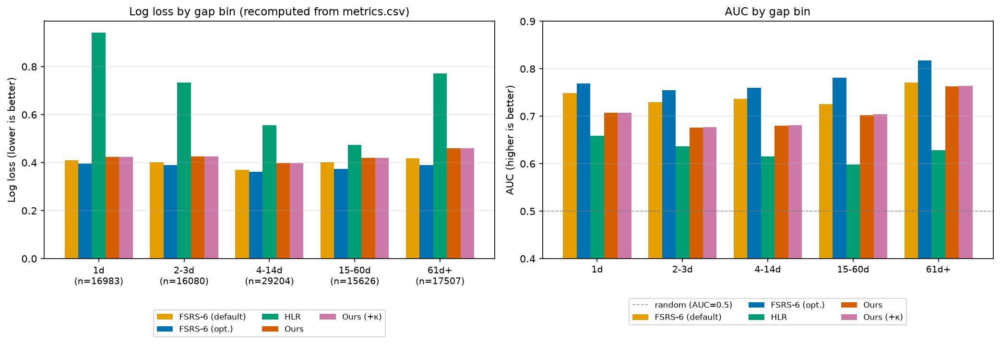
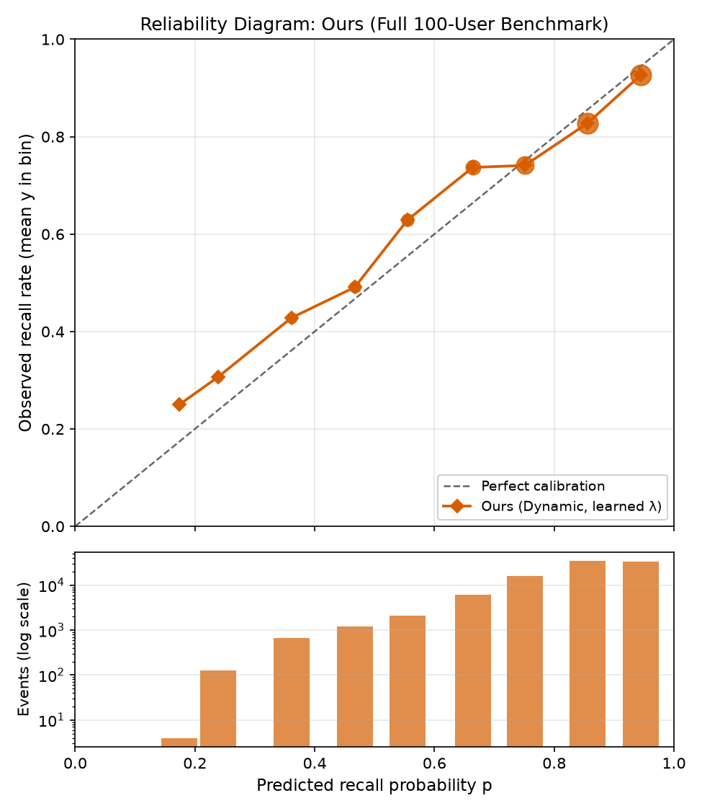

# Baseline Validation and Statistical Analysis Report

**Date:** 2026-11-01

**Target Modules:**
- `fsrs_benchmark/models/hlr.py`
- `baselines.py`
- `fsrs_benchmark/metrics.py`
- `fsrs_benchmark/models/ours.py`
- `AnkiFirstRun/dynamic_retention_dt.py`
- `pg_sampler.py`
- `all_baselines.py` — legacy HLR implementation, inspected for comparison
 
**Dataset Reference:** `results/full_u100_c1000/` (Anki-10k benchmark: 100 users, 95,400 scored events)

---

## 1. Executive Summary

This report presents a comprehensive implementation audit and statistical validation of the baseline recall models, including Half-Life Regression (HLR) and Lagged Logistic Regression with time-gap features (LagLogit+dt). It also evaluates the benchmark metric implementations (Log Loss, Brier Score, AUC and Expected Calibration Error), paired user-cluster bootstrap methodology, and saved empirical benchmark results.

The evaluation additionally examines the Dynamic Bayesian Retention Model, referred to as "Ours" in the benchmark results, as a separate supplementary model.

### Key Conclusions

1. **Model Formulations and Probability Validity:**
   - The benchmark HLR implementation (`fsrs_benchmark/models/hlr.py`) follows the intended Settles & Meeder (2016) formulation. Independent numerical checks of the forgetting curve, feature construction, sequential SGD updates, regularisation and prediction bounds passed.
   - The legacy implementation in `all_baselines.py` uses a different objective and feature construction and must not be conflated with the benchmark HLR implementation.
   - LagLogit+dt, implemented through `LaggedLogistic(use_dt=True)` in `baselines.py`, passed independent synthetic validation of historical features, lagged-outcome continuity, time-gap transformation, sequential prediction, probability validity and reproducibility.

2. **Metric Implementations:**
   - Log Loss, Brier Score, AUC and ECE passed independent hand-calculated and synthetic validation checks.
   - AUC validation covered tied predictions, single-class handling and brute-force pairwise comparisons.
   - ECE implements equal-width probability binning with weighted calibration error.

3. **Paired Bootstrap and Clustering:**
   - The paired bootstrap resamples user-level blocks with replacement and evaluates both models on identical sampled users.
   - This preserves within-user dependence, including dependence among review events and card trajectories.
   - The methodology accounts for clustered observations, although user-level resampling is not guaranteed to produce conservative confidence intervals in every setting.

4. **Empirical Benchmark Performance:**
   - FSRS-6 Optimised achieved the strongest overall performance among the evaluated models in the 100-user benchmark.
   - HLR exhibited substantially higher prediction error and weaker discrimination compared with FSRS-6 and the Dynamic Bayesian model.
   - The Dynamic Bayesian model achieved intermediate predictive performance but exhibited poor MCMC convergence diagnostics.

5. **Dynamic Bayesian Model Limitations:**
   - The saved MCMC diagnostics indicate poor convergence ($\hat{R}_\lambda \approx 2.4$, ESS approximately 3), so its empirical results should be interpreted as provisional.
   - A potential FFBS padding-related issue was identified during supplementary source inspection and is documented as an unverified observation outside the primary baseline validation scope.

---

## 2. Model Audits

### 2.1 Half-Life Regression (HLR)

**Mathematical Specification:**

$$p = 2^{-t/h}, \quad h = 2^{\theta^\top x}$$

Features $x = \left[\sqrt{1 + n_{\text{right}}},\ \sqrt{1 + n_{\text{wrong}}},\ 1\right]$ count prior successes and failures on the specific card by that user.

**SGD Gradients (with respect to weight vector $\theta$):**

$$\nabla_\theta \ell_p = 2(p - p_{\text{obs}}) \ln^2(2)\, p\, \frac{t}{h}\, x$$

$$\nabla_\theta \ell_h = 2(h - h_{\text{obs}}) \ln(2)\, h\, x$$

where $p_{\text{obs}}$ is the clipped observed recall outcome $\operatorname{clip}(y,\,P_{\min},\,P_{\max})$ and $h_{\text{obs}} = \operatorname{hclip}\!\left(-t / \log_2(p_{\text{obs}})\right)$ is the observed half-life target, both as defined in the implementation's training formulation.

**Findings and Verification:**

- `_sgd_epoch` in `hlr.py` was audited against the intended implementation in Duolingo's Settles & Meeder (2016) work.
- Per-feature adaptive learning rates and sequential SGD updates were independently checked.
- The forgetting-curve calculation, half-life transformation, historical feature construction and L2 regularisation behaviour passed the implemented validation checks.
- Predictions are clipped to the interval $[10^{-4}, 1 - 10^{-4}]$, ensuring valid probability outputs.
- The relatively low AUC (0.555) is not explained by an implementation defect identified during this audit. The absence of lexical or item-difficulty features may contribute to weaker ranking performance, but this explanation remains a hypothesis rather than an established cause.

**Legacy Implementation Distinction:**

The separate `all_baselines.py` implementation uses an MSE-based objective, L-BFGS-B optimisation and sequence-position features. It is not the benchmark HLR implementation and should not be treated as an equivalent reproduction of the Settles & Meeder baseline.

---

### 2.2 Lagged Logistic Regression with Time-Gap Features (LagLogit+dt)

**Implementation:** `baselines.py`, class `LaggedLogistic(use_dt=True)`.

**Mathematical Specification:**

The model uses logistic regression with lagged review outcomes, historical review counts, time-gap features and optional user/item fixed effects:

$$\operatorname{logit}(p_{u,i,t}) = b_0 + a\,\ell_{u,i,t} + b\sqrt{n_{\text{right}}} + c\sqrt{n_{\text{wrong}}} + d\log(1 + \Delta t) + \text{item effect} + \text{user effect}$$

Here, $\ell_{u,i,t}$ represents the lagged review outcome and $\Delta t$ denotes the time gap since the previous review.

**Implementation Details:**
- Historical success and failure counts are constructed using prior reviews.
- The first test prediction uses the last available training outcome as its lagged feature.
- Subsequent test predictions use the preceding observed test outcome.
- The time-gap feature is transformed using $\log(1 + \Delta t)$.
- Optional item and user fixed effects are incorporated into the design matrix.
- Parameters are estimated using penalised logistic negative log-likelihood and L-BFGS-B optimisation.

**Independent Synthetic Validation:**

The implementation was evaluated using independently constructed synthetic test sequences. The validation covered historical review-count features, lagged-outcome continuity across training and test sequences, time-gap transformation, design-matrix construction, sequential prediction without current/future outcome leakage, probability validity and reproducibility.

The synthetic optimisation run terminated successfully under L-BFGS-B, with a finite penalised objective and a small final gradient norm.

| Diagnostic | Result |
|---|---|
| Optimiser | L-BFGS-B |
| Termination status | Success |
| Iterations | 45 |
| Final penalised objective | 425.2552 |
| Gradient infinity norm | 0.007015 |

All implemented validation checks passed, establishing implementation-level consistency under the tested synthetic scenarios.

---

### 2.3 Dynamic Bayesian Retention Model — Supplementary Audit

**Implementation:** `AnkiFirstRun/dynamic_retention_dt.py`, with benchmark adapter `fsrs_benchmark/models/ours.py`.

This is a separate model from LagLogit+dt and is referred to as "Ours" in the empirical benchmark results.

**Transition Dynamics:**

The model uses a review-history-dependent continuous-time Ornstein-Uhlenbeck transition. The effective decay rate incorporates an optional accumulated review-history term:

$$L_{u,i,t} = \lambda \exp(-\kappa\, C_{u,i,t})$$

$$\phi_{u,i,t} = \exp(-L_{u,i,t}\, \Delta t)$$

$$q_{u,i,t} = \frac{\sigma^2}{2L_{u,i,t}}\left(1 - \exp(-2L_{u,i,t}\, \Delta t)\right)$$

where $C_{u,i,t}$ represents the relevant accumulated review-history count for user $u$, item $i$ at time $t$. When $\kappa = 0$, the effective rate reduces to $L = \lambda$ and the transition simplifies to the standard OU formulation with decay rate $\lambda$. The implementation uses `expm1` for improved numerical stability when the exponent is small.

**FFBS and Latent Variable Sampling:**

The model uses Forward Filtering Backward Sampling (FFBS) for latent-state inference and Polya-Gamma augmentation for logistic observation modelling. The Kalman filtering and backward-smoothing equations were inspected against the intended state-space formulation.

**Train/Test Continuity and Prediction:**

The prediction pipeline was examined for preservation of training history, including the last training latent state, first test time gap and preceding review outcomes. Predictions follow a sequential one-step-ahead evaluation process using available past information.

**MCMC Convergence:**

The saved diagnostics indicate poor convergence, with $\hat{R}_\lambda \approx 2.4$ and effective sample size (ESS) approximately 3. Consequently, the Dynamic Bayesian model's empirical results should be interpreted as provisional pending improved sampling and convergence.

**Polya-Gamma Sampler Approximation:**

The supplementary `pg_sampler.py` implementation uses a 200-term truncated Gamma-series approximation for Polya-Gamma sampling. Its self-test compares empirical means with theoretical means at selected parameter values. This mean-based validation does not independently establish full distributional accuracy or posterior validity.

**Supplementary FFBS Observation:**

During source inspection, a potential issue was identified in the FFBS backward-sampling implementation for sequences of unequal lengths with padded positions. Terminal-state handling may allow padded positions to influence the final valid latent state of shorter sequences. This observation was not investigated further or corrected because validation of the Dynamic Bayesian sampler falls outside the primary baseline validation scope. It is therefore recorded as a potential limitation rather than a confirmed implementation defect.

---

## 3. Statistical Metrics Verification

The implementations in `fsrs_benchmark/metrics.py` were independently validated using hand-calculated examples, synthetic inputs and separately implemented reference calculations.

| Metric | Codebase Function | Independent Validation |
|---|---|---|
| **Log Loss** | `log_loss` | Hand-calculated cases, probability clipping and boundary predictions |
| **Brier Score** | `brier` | Hand-calculated mean squared probability error |
| **AUC** | `auc` | Known cases, tied predictions, single-class handling and brute-force pairwise comparisons |
| **ECE** | `ece` | Hand-calculated cases and independent binning implementation |

**Implementation Details:**
- **Log Loss:** Binary cross-entropy with probabilities clipped to $[10^{-6}, 1 - 10^{-6}]$.
- **Brier Score:** Mean squared difference between predicted probabilities and binary outcomes.
- **AUC:** Mann-Whitney U / rank-based calculation with average-rank handling for tied predictions. Returns NaN when only one outcome class is present.
- **ECE:** Equal-width probability bins. The final bin includes predictions equal to 1. The weighted absolute difference between mean predicted probability and observed frequency is calculated for each non-empty bin. Empty bins do not contribute.

The independent AUC validation used a brute-force pairwise comparison implementation. A separate scikit-learn cross-check was not performed.

### High-Recall Behaviour Note

The benchmark has an overall recall of approximately 83.1%, with most observations concentrated in higher predicted-probability bins. The first reliability bin contains only four events, while the tenth bin is empty in the saved reliability summary.

Consequently, the ECE value is dominated by higher-volume bins. Its weighted formulation reduces the influence of sparsely populated bins on the overall calibration error.

---

## 4. Paired Bootstrap and Clustering Audit

### Audit of `paired_bootstrap()`

- **Resampling Unit:** User-level blocks are resampled with replacement ($B = 1,000$, seed 0).
- **Paired Evaluation:** Both models are evaluated on the same sampled user blocks, preserving the paired comparison.
- **Trajectory Dependencies:** All review events belonging to a sampled user are retained together, preserving dependence among that user's card trajectories.
- **Confidence Interval:** The 2.5th and 97.5th percentiles of the valid bootstrap metric differences are used to construct the 95% confidence interval.
- **Non-finite Samples:** Non-finite bootstrap differences are excluded from the percentile calculation.

### Empirical Width Comparison

In a synthetic autocorrelated test scenario:

| Bootstrap Method | Approximate 95% CI Width |
|---|---|
| Event-level bootstrap | 0.034 |
| User-cluster bootstrap | 0.118 |

In this synthetic example, user-cluster resampling produced a wider interval than event-level resampling, illustrating the potential underestimation of uncertainty when correlated review events are treated as independent observations.

This result is specific to the tested scenario. User-cluster bootstrap is not guaranteed to produce wider or conservative intervals in every setting. The implementation resamples users rather than independently resampling card trajectories.

The reported metric is event-weighted: users with more review events contribute more observations, while uncertainty is estimated through user-level resampling.

### Paired Difference Convention

The implementation calculates:

$$\Delta = \text{Metric(model)} - \text{Metric(reference)}$$

Therefore:
- Positive Log Loss difference indicates worse performance.
- Positive Brier Score difference indicates worse performance.
- Positive AUC difference indicates better performance.
- Positive ECE difference indicates higher calibration error.

---

## 5. Full-Run Benchmark Results and Confidence Intervals

### Overall Predictive Performance

| Model | Log Loss | Brier | AUC | ECE | Mean Bias |
|---|---|---|---|---|---|
| **FSRS-6 Optimised** | **0.3794** | **0.1169** | **0.7766** | **0.0091** | **-0.0019** |
| FSRS-6 Default | 0.3960 | 0.1208 | 0.7449 | 0.0117 | +0.0113 |
| HLR | 0.6805 | 0.1698 | 0.5554 | 0.1464 | +0.0604 |
| Ours (Dynamic, learned $\lambda$) | 0.4221 | 0.1313 | 0.6921 | 0.0252 | +0.0108 |
| Ours (+$\kappa$) | 0.4219 | 0.1313 | 0.6931 | 0.0255 | +0.0110 |

The empirical comparison includes FSRS-6 Default, FSRS-6 Optimised, HLR and the Dynamic Bayesian Retention Model variants. LagLogit+dt is separately covered by the implementation-level synthetic validation in Section 2.2 and is not represented by the "Ours" rows in this benchmark table. Its empirical performance should therefore be reported separately from the Dynamic Bayesian model.

### Paired Differences (95% User-Clustered Bootstrap CI)

Differences are calculated as model minus reference.

| Comparison | Metric | Difference | 95% CI |
|---|---|---|---|
| Ours vs FSRS-6 Optimised | Log Loss | +0.0427 | [0.0327, 0.0554] |
| Ours vs FSRS-6 Optimised | Brier | +0.0145 | [0.0106, 0.0193] |
| Ours vs FSRS-6 Optimised | AUC | -0.0845 | [-0.1096, -0.0644] |
| Ours vs FSRS-6 Optimised | ECE | +0.0161 | [0.0013, 0.0274] |
| HLR vs FSRS-6 Optimised | Log Loss | +0.3011 | [0.2455, 0.3605] |
| HLR vs FSRS-6 Optimised | Brier | +0.0529 | [0.0401, 0.0667] |
| HLR vs FSRS-6 Optimised | AUC | -0.2212 | [-0.2771, -0.1731] |
| HLR vs FSRS-6 Optimised | ECE | +0.1373 | [0.1134, 0.1565] |

The confidence intervals indicate that FSRS-6 Optimised outperforms HLR and the Dynamic Bayesian model on the listed metrics in the evaluated benchmark.

For Ours versus Ours+$\kappa$, the paired confidence intervals include zero for Log Loss, Brier Score, AUC and ECE. Therefore, the benchmark does not establish a statistically significant improvement from the $\kappa$ extension.

The two prediction sets have a Pearson correlation of 0.9923, with a maximum absolute difference of 0.0935 across 95,400 events. This indicates similar overall prediction patterns but does not independently establish predictive validity or MCMC convergence.

---

## 6. Generated Visual Artifacts

### 6.1 Gap-Stratified Performance

The gap-stratified performance comparison is shown below.

*Figure 1: Comparison of model performance across different retention-interval bins.*

The comparison shows FSRS-6 Optimised exhibiting the strongest overall performance across the reported retention-interval bins. HLR demonstrates substantially weaker performance, particularly at shorter and longer retention intervals. These observations are based on the saved benchmark metric summaries.

### 6.2 Reconstructed Reliability Diagram — Dynamic Bayesian Model (Ours)

The reconstructed reliability diagram for the Dynamic Bayesian model is shown below.

*Figure 2: Reliability diagram reconstructed from the saved calibration-bin summaries.*

The reliability diagram is reconstructed from the rounded `ours_reliability_bins` values in `supplementary.json`, rather than raw event-level predictions. It shows underconfidence in the lower and middle probability bins, particularly around the 0.55 predicted-probability bin, where observed recall is approximately 0.63. In the higher probability bins, observed recall is slightly below predicted probability, indicating mild overconfidence.

The ECE calculated from the rounded bin summaries is approximately 0.02562, compared with the saved ECE of 0.025204. This difference is consistent with precision loss from rounded bin summaries, although it cannot be conclusively established without the unrounded event-level predictions.

## 7. Audit Summary of Corrections and Recommendations

1. **Model Identification:** Clearly distinguish HLR, LagLogit+dt and the Dynamic Bayesian Retention Model. The OU, FFBS and Polya-Gamma components belong to the Dynamic Bayesian model, not LagLogit+dt.
2. **Legacy HLR Implementation:** Maintain a clear distinction between the benchmark HLR implementation in `fsrs_benchmark/models/hlr.py` and the legacy prototype in `all_baselines.py`.
3. **LagLogit+dt Validation:** The implementation passed independent synthetic validation of historical features, lagged-outcome continuity, time-gap transformation, sequential prediction, probability validity and reproducibility.
4. **Metric Implementations:** Log Loss, Brier Score, AUC and ECE passed independent hand-calculated and synthetic validation checks.
5. **Paired Bootstrap:** User-cluster resampling preserves within-user dependence and paired model comparisons. However, it is not guaranteed to produce conservative or wider intervals in every scenario.
6. **Dynamic Bayesian Convergence:** Poor MCMC diagnostics ($\hat{R}_\lambda \approx 2.4$, ESS approximately 3) make the corresponding empirical results provisional.
7. **FFBS Observation:** A potential unequal-length padding issue was noted during supplementary source inspection. It remains unverified and was not investigated further because it falls outside the primary audit scope.
8. **Reliability Visualisation:** The reliability diagram is reconstructed from rounded summaries and should not be described as an independently regenerated event-level reliability plot.
9. **Documentation Consistency:** Update model names, target modules, file references and conclusions so that every claim corresponds to the correct implementation and available evidence.
10. **Validation Artifacts:** Independent validation scripts and generated audit artifacts are maintained under `scratch/` to support reproducibility.

### Overall Conclusion

The HLR and LagLogit+dt implementations passed their respective implementation-level validation checks. The metric implementations and paired user-cluster bootstrap methodology also passed independent synthetic and hand-calculated validation.

In the evaluated 100-user benchmark, FSRS-6 Optimised achieved the strongest overall predictive performance among the compared models. HLR showed substantially weaker predictive performance, while the Dynamic Bayesian model achieved intermediate results but requires further MCMC convergence improvements.

The results collectively support the correctness of the tested baseline implementations and metric methodology, while highlighting the importance of convergence diagnostics and careful interpretation of clustered statistical comparisons.

---

## 8. Validation Test Execution

| Test Category | Result |
|---|---|
| HLR targeted tests | 19 passed, 5 skipped |
| Metrics and related targeted tests | 73 passed, 5 skipped |
| Full test suite | 173 passed, 4 failed, 83 skipped |
| LagLogit+dt synthetic validation | All implemented checks passed |
| Independent metrics validation | All implemented checks passed |
| Independent paired bootstrap validation | All implemented checks passed |

### Full Test Suite Observations

Four failures occurred in real-user data verification tests:
- `test_real_user_invariants[6370]`
- `test_real_user_invariants[8506]`
- `test_real_user_day_gap_equals_elapsed_days[6370]`
- `test_real_user_day_gap_equals_elapsed_days[8506]`

These tests reference hardcoded Linux paths for Anki parquet files belonging to users 6370 and 8506. The paths are environment-specific and require the corresponding dataset files to execute successfully. These failures do not, by themselves, demonstrate model implementation defects.

The 83 skipped tests were not evaluated in this test execution.
