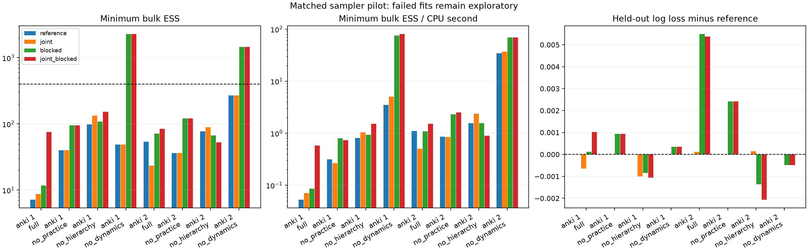

# Task 3 — actual Anki observations, 28 October 2026

## Follow-up integrity correction

The [dynamics investigation](TASK3_DYNAMICS_REPORT.md) finds that the earlier
adjacent-gap eligibility check is insufficient for whole-history consistency:
one of the 60 selected histories fails a cumulative day-floor check. The saved
cohorts and results below are preserved as a matched provisional-data pilot,
not an authenticated complete-history extract.

## Scope

The preceding sampler study used synthetic data to support known-truth recovery.
It did not establish sampler behavior on the available Anki extract. This follow-up
uses the actual local Anki Parquet files for convergence, controlled component
ablations, held-out predictions and computational comparisons. No real-data
parameter-recovery or calibrated coverage claim is possible without known truth.
FSRS benchmarking and additional statistical baselines remain teammates' Tasks 1–2.

## Source and integrity audit

The repository contains `AnkiFirstRun/train_data.parquet` (2,131,995 events) and
`AnkiFirstRun/test_data.parquet` (532,999 events): **2,664,994 observed reviews**.
The train partition contains 30 users and test contains 11. The upstream extract's
original version/provenance is not documented here; local file SHA-256 values,
row counts and the installed PyArrow version are recorded for reproducibility.
`processed_sequences.pkl` is used by the Duolingo loader and is not an Anki source.

The existing train/test assignment is preserved. Train timestamps span days
0–1247 and test days 1247–2671. A sequence is eligible only if its final train
day is strictly before its first test day; overlapping boundary days are excluded
because the stored timestamps do not resolve their ordering. Within each partition,
stable timestamp sorting retains source row order for same-day ties; original
intra-day ordering cannot be independently authenticated from these files.

`delta_t` is integer days. `elapsed_seconds` supplies finer recorded intervals;
we use `elapsed_seconds / 86400` in the continuous-time OU equations. The initial
gap remains unused. Subsequent gaps must be positive and within 1 second–3650
days. No silent clipping is performed. This expands the input validation/numerical
domain relative to the synthetic/upload interface's 0.01–365 days, without changing
the OU equations or parameter priors. Every sampler in this comparison uses the
same domain. These runs are therefore not a reproduction of older Anki scripts
that clipped actual gaps to the old bounds.

A source gap must agree with the preceding available review's timestamp difference
to within one day, the timestamp resolution. Many otherwise usable card histories
fail this check. For example, one card advances 64 timestamp days while its next
review reports only 153 elapsed seconds. A missing preceding review or another
upstream transformation is plausible; the files alone cannot establish its cause.
The model must not silently treat those rows as a complete observed trajectory.
We exclude the entire affected history rather than bridging or inventing outcomes.
This is conservative data selection, not a repair of the extract. Internal timing
consistency does not prove complete lifetime history: reviews before the first
available row and missing same-day events may remain unknown. Practice counts
restart at the observed window, and the existing first-state prior is retained.
Left truncation therefore limits interpretation of practice-dependent decay,
even if a sampler were to pass diagnostics.

Of 68,992 user/card histories with test observations:

| Sequential eligibility check | Histories excluded |
|---|---:|
| Fewer than 6 training or 2 test observations | 62,538 |
| More than 60 total observations | 614 |
| Train/test boundary days overlap | 14 |
| Invalid elapsed-time domain | 0 |
| Inconsistent adjacent timestamp / elapsed interval | 4,730 |
| Remaining complete eligible histories | 1,096 |

Selection does not filter on recall outcomes. Binary `y` is checked against
`rating > 1`. Complete eligible histories are retained without truncation; all
practice counts and lag outcomes use their observed chronological history.
Length and follow-up eligibility still select a special subset of learners/cards.
The retained histories cannot represent the entire extract without further study.

## Fixed matched protocol

Six users have at least ten eligible cards under this protocol. A seeded user
permutation creates **two disjoint cohorts of three users**, and a user-specific
seeded sample selects ten cards per user: 30 histories per cohort. Item identities
are the pair `(source user, source item)`, so card IDs remain nested within users
and cannot accidentally share effects merely because numeric IDs coincide.
Original-ID mappings and raw selected observations remain in ignored local runs.

Four samplers (`reference`, `joint`, `blocked`, `joint_blocked`) each fit full,
no-practice, no-hierarchy and no-dynamics variants on both cohorts. Four chains
per fit, 8,000 iterations, 4,000 warmup, no thinning, five MH proposals per sweep:
**128 computed chains, 32 fits**. Source hashes, dataset hashes and provided split
indices are saved. Proposal covariance adapts only during warmup. Priors remain
identical to the synthetic sampler comparison. OpenBLAS/OpenMP use one thread.

The unchanged whole-fit gate requires rank-normalized folded split R-hat <1.01
and bulk/tail ESS >=400 for every monitored scalar. Terminal states and hierarchical
effects are included. Predictive filtering remains the inherited approximation;
outcomes update the filter only after their own prediction. Test observations
never choose the sampler settings or determine cohort membership by outcome.
User-cluster intervals have only three clusters per cohort and are fragile.

This is an actual-data **cohort diagnostic pilot**, not a full 2.66-million-event
MCMC fit or a real-world efficacy result. Full-scale analysis needs a separately
validated scaling strategy for the state arrays and coefficient blocks. Synthetic
recovery remains a complementary implementation check, not a substitute for this
real-data evaluation.

## Identifiability under user-nested cards

The synthetic design crossed users and shared items; Anki cards here are nested
within users. For each user, shifting alpha_u by d and all of that user's card
effects by -d leaves the likelihood unchanged. Global post-hoc centering of alpha
and beta does not remove those user-specific symmetries. Proper priors allocate
the offsets; raw ability and card difficulty cannot be separately identified by
the likelihood alone. Within-user card contrasts and combined user levels
`b0 + alpha_u + mean(beta_cards_of_user)` are more appropriate interpretations.
The existing raw/centered monitoring remains stringent and unchanged; passing it
would concern Monte Carlo behavior, not a proof of separate identification.

Left-truncated practice counts, only three users per cohort, endogenous review
gaps, and the observed time-integrity exclusions further limit component
interpretation. These differ from known-truth synthetic identifiability checks.

## Measured results

All **128 chains and 32 fits completed**. **4/32 fits pass** the prespecified whole-fit gate. Full-model fits pass 0/8. Completion is not convergence.

The four sampler runs share observations and seeds. In no-practice fits the
joint kernel falls back to scalar lambda; in static fits it is inactive. Thus
reference/joint trajectories coincide for those two variants, as do
blocked/joint_blocked trajectories. The 128 computed chains contain 96 distinct
trajectories; these are two real-data cohorts, not 32 independent datasets.

| Cohort | Model | Sampler | Max R-hat | Min bulk / tail ESS | Min bulk ESS / CPU s | Fit CPU s | Log loss | Brier | Gate |
|---|---|---|---:|---:|---:|---:|---:|---:|---|
| 1 | full | reference | 1.5595 | 7.1 / 18.8 | 0.05 | 135.7 | 0.43469 | 0.13509 | FAIL |
| 1 | no_practice | reference | 1.0959 | 39.8 / 65.5 | 0.31 | 127.6 | 0.43457 | 0.13519 | FAIL |
| 1 | no_hierarchy | reference | 1.0451 | 98.2 / 228.6 | 0.81 | 121.3 | 0.50165 | 0.15985 | FAIL |
| 1 | no_dynamics | reference | 1.0693 | 49.0 / 36.4 | 3.48 | 14.1 | 0.45289 | 0.14089 | FAIL |
| 2 | full | reference | 1.0932 | 54.0 / 48.5 | 1.10 | 48.9 | 0.57690 | 0.16174 | FAIL |
| 2 | no_practice | reference | 1.0911 | 36.2 / 51.7 | 0.86 | 42.3 | 0.58567 | 0.16120 | FAIL |
| 2 | no_hierarchy | reference | 1.0353 | 77.6 / 177.5 | 1.55 | 50.0 | 0.52656 | 0.14980 | FAIL |
| 2 | no_dynamics | reference | 1.0115 | 270.6 / 356.9 | 34.30 | 7.9 | 0.61648 | 0.18209 | FAIL |
| 1 | full | joint | 1.3888 | 8.7 / 15.0 | 0.07 | 123.1 | 0.43405 | 0.13465 | FAIL |
| 1 | no_practice | joint | 1.0959 | 39.8 / 65.5 | 0.27 | 150.2 | 0.43457 | 0.13519 | FAIL |
| 1 | no_hierarchy | joint | 1.0346 | 133.7 / 241.6 | 1.04 | 128.6 | 0.50064 | 0.15972 | FAIL |
| 1 | no_dynamics | joint | 1.0693 | 49.0 / 36.4 | 5.07 | 9.7 | 0.45289 | 0.14089 | FAIL |
| 2 | full | joint | 1.1341 | 23.3 / 37.5 | 0.51 | 46.2 | 0.57701 | 0.16119 | FAIL |
| 2 | no_practice | joint | 1.0911 | 36.2 / 51.7 | 0.85 | 42.6 | 0.58567 | 0.16120 | FAIL |
| 2 | no_hierarchy | joint | 1.0422 | 89.4 / 46.7 | 2.37 | 37.7 | 0.52670 | 0.14973 | FAIL |
| 2 | no_dynamics | joint | 1.0115 | 270.6 / 356.9 | 36.96 | 7.3 | 0.61648 | 0.18209 | FAIL |
| 1 | full | blocked | 1.2834 | 11.7 / 26.8 | 0.09 | 136.3 | 0.43481 | 0.13478 | FAIL |
| 1 | no_practice | blocked | 1.0183 | 95.5 / 284.1 | 0.80 | 119.5 | 0.43550 | 0.13543 | FAIL |
| 1 | no_hierarchy | blocked | 1.0330 | 109.0 / 153.8 | 0.93 | 117.0 | 0.50081 | 0.15966 | FAIL |
| 1 | no_dynamics | blocked | 1.0009 | 2284.9 / 3803.3 | 75.33 | 30.3 | 0.45325 | 0.14087 | PASS |
| 2 | full | blocked | 1.0689 | 71.3 / 196.5 | 1.08 | 66.0 | 0.58239 | 0.16336 | FAIL |
| 2 | no_practice | blocked | 1.0435 | 121.6 / 244.1 | 2.29 | 53.0 | 0.58808 | 0.16139 | FAIL |
| 2 | no_hierarchy | blocked | 1.0662 | 66.7 / 107.5 | 1.56 | 42.8 | 0.52520 | 0.14937 | FAIL |
| 2 | no_dynamics | blocked | 1.0043 | 1452.3 / 2676.3 | 69.30 | 21.0 | 0.61599 | 0.18204 | PASS |
| 1 | full | joint_blocked | 1.0536 | 75.8 / 170.7 | 0.58 | 130.0 | 0.43571 | 0.13512 | FAIL |
| 1 | no_practice | joint_blocked | 1.0183 | 95.5 / 284.1 | 0.73 | 130.6 | 0.43550 | 0.13543 | FAIL |
| 1 | no_hierarchy | joint_blocked | 1.0263 | 152.1 / 401.8 | 1.51 | 100.5 | 0.50058 | 0.15966 | FAIL |
| 1 | no_dynamics | joint_blocked | 1.0009 | 2284.9 / 3803.3 | 80.69 | 28.3 | 0.45325 | 0.14087 | PASS |
| 2 | full | joint_blocked | 1.0459 | 84.7 / 246.7 | 1.52 | 55.7 | 0.58228 | 0.16071 | FAIL |
| 2 | no_practice | joint_blocked | 1.0435 | 121.6 / 244.1 | 2.51 | 48.5 | 0.58808 | 0.16139 | FAIL |
| 2 | no_hierarchy | joint_blocked | 1.0649 | 52.9 / 294.1 | 0.89 | 59.3 | 0.52449 | 0.14995 | FAIL |
| 2 | no_dynamics | joint_blocked | 1.0043 | 1452.3 / 2676.3 | 69.21 | 21.0 | 0.61599 | 0.18204 | PASS |

### Dataset sizes and timing domain

| Cohort | Users / cards | Training / test reviews | Minimum / maximum gap (days) | Gaps below 0.01 / above 365 days |
|---|---:|---:|---:|---:|
| 1 | 3 / 30 | 426 / 181 | 0.00005787 / 1101.083 | 103 / 10 |
| 2 | 3 / 30 | 242 / 111 | 0.00005787 / 2141.436 | 43 / 21 |

Together these fixed cohorts contain **960 real reviews on 60 cards from six
users**, 668 training and 292 held out. The source-file scan covers all 2.66 million
rows; posterior inference in this pilot uses the selected 960 observations.
The eligibility restriction and small cohort size prevent extrapolation to all
Anki users or the full local extract.

### Remaining dynamic-model failures

Every failed scalar is available in each diagnostics.csv. The following lists
failing core decay/diffusion/hierarchy-scale parameters for the full model, with
R-hat / bulk ESS. Additional effects and terminal states may fail too; this list
is not the whole-fit gate.

| Cohort | Sampler | Failing core parameters |
|---|---|---|
| 1 | reference | b0: 1.560 / 7; tau2_alpha: 1.037 / 85; tau2_beta: 1.020 / 228; lam: 1.081 / 70; sigma2: 1.030 / 167; kappa: 1.093 / 52 |
| 2 | reference | b0: 1.065 / 60; tau2_alpha: 1.035 / 118; tau2_beta: 1.028 / 209; lam: 1.085 / 54; sigma2: 1.024 / 316; kappa: 1.093 / 59 |
| 1 | joint | b0: 1.389 / 9; tau2_alpha: 1.101 / 28; tau2_beta: 1.019 / 187; lam: 1.019 / 197; sigma2: 1.020 / 258; kappa: 1.064 / 100 |
| 2 | joint | b0: 1.041 / 92; tau2_alpha: 1.052 / 62; tau2_beta: 1.016 / 413; lam: 1.059 / 59; sigma2: 1.011 / 315; kappa: 1.031 / 73 |
| 1 | blocked | b0: 1.032 / 114; tau2_beta: 1.016 / 262; lam: 1.232 / 16; sigma2: 1.016 / 225; kappa: 1.283 / 12 |
| 2 | blocked | lam: 1.023 / 121; sigma2: 1.007 / 366; kappa: 1.069 / 93 |
| 1 | joint_blocked | b0: 1.014 / 681; tau2_beta: 1.011 / 280; lam: 1.015 / 184; sigma2: 1.028 / 173; kappa: 1.030 / 116 |
| 2 | joint_blocked | tau2_beta: 1.011 / 588; lam: 1.012 / 188; sigma2: 1.018 / 261; kappa: 1.046 / 85 |

## Interpretation and decisions

With coefficient blocking, both static cohorts pass (minimum bulk ESS
2,285 and 1,452), compared with 49 and 271 for reference. The combined full
kernel improves cohort 1 from R-hat 1.560 / minimum bulk ESS 7.1 to
1.054 / 75.8, and cohort 2 from 1.093 / 54.0 to 1.046 / 84.7. These are
improvements in sampling, but neither fit is close to a whole-fit pass.
Minimum bulk ESS per CPU second increases from 0.053 to 0.583 on the first
cohort and 1.104 to 1.521 on the second. The benefit is cohort-dependent.

Under the combined sampler, removing hierarchy changes held-out log loss by
+0.0649 on cohort 1 and -0.0578 on cohort 2. Removing practice changes it by
-0.0002 and +0.0058. Removing dynamics changes it by +0.0175 and +0.0337.
These measured point contrasts do not validate a component: every dynamic fit
involved fails diagnostics, and the three-cluster intervals are fragile.

Cohort 1's combined kappa interval is negative [-2.115,-0.050], while cohort 2's
spans zero [-2.049,1.319]. Both kappa chains fail diagnostics. This cannot establish
an effect in either direction; it especially does not justify forcing kappa
positive to recover the desired mechanism. Broad decay/diffusion intervals,
left-truncated counts and nested effects require further investigation.

The synthetic-only conclusion was insufficient for real-data inference. Anki's
nested effects and its observed timing/history patterns produce much harder
mixing. Joint decay proposals and exact coefficient blocking preserve the target
but do not establish converged inference for the full model at this budget.
Any improved individual parameter diagnostics must be read alongside whole-fit
failure. Predictive point estimates from failed fits cannot rank components or
validate a practice-dependent mechanism.

The point scores and CPU-normalized ESS are measured on identical real
observations for each kernel. CPU is summed fitting process time across chains;
data preparation and plotting are outside that denominator and included in job
wall time. Prediction CPU is recorded separately. These are hardware-specific
single timing realizations, not repeated computational benchmark distributions.
Ablation intervals use only three user clusters and omit posterior simulation
uncertainty. Passing a static fit would validate its Monte Carlo behavior on this
cohort, not prove that removing dynamics is predictively optimal.

There is no real-data recovery column: the true parameters are unknown. Priors
and model equations were not tuned against held-out scores. The original Anki
logs used different preprocessing/single-chain settings and are not used as
matched convergence evidence here. The two-cohort study adds real-data evidence;
it does not replace the synthetic known-truth checks.

Non-centered hierarchy or latent-innovation parameterizations remain plausible
sampler-only hypotheses. Unlike the easier synthetic case, Anki also exposes
slow hierarchy scales under some kernels. This warrants testing rather than a
claim that hierarchy non-centering is unnecessary. Any implementation must retain
the current priors and account for transformations correctly. Additional chain
budgets, prior sensitivity, broader cohorts and extract-integrity work must remain
separate investigations; neither threshold relaxation nor a changed prior should
be presented as successful sampling of this model.

## Artifacts and validation

Reproducible configs: `experiments/task3-anki-{sampler}.json`. Full draws, warmup,
selected observations and original-ID mappings remain in ignored
`.task3-runs/task3-anki-*`. Curated aggregate tables, reports, source/package
provenance, chain metadata and selected figures are in
`experiments/results/task3-anki-*`. Curated selection metadata omits original IDs.
No input Anki files, old study outputs, teammate baselines or unrelated research
work were modified. No changes were pushed.

[Matched sampler tables](results/task3-anki-comparison/report.md) include all 32
fits, per-parameter ESS/CPU comparisons and posterior MCSE agreement screens.
Those screens are descriptive when convergence fails. Tests cover provided split
preservation, disjoint cohorts, user-nested item IDs, outcome-independent selection,
no time clipping, invalid/missing history exclusions and existing kernel checks.
Validation passed: `npm run test:diagnostics` (12 tests), `npm run test:bayesian`
(2 Node tests plus 3 Python tests), `npm run typecheck`, focused Biome checks on
all four changed TypeScript/TSX files and `npm run build`. Repository-wide lint
retains the unrelated failures documented in the preceding report (280 errors,
240 warnings in that run); the build retains workspace-root/tracing and Node
warnings. No unrelated formatting or fixes were applied.

Manual checks covered the Anki source controls, preserved-partition settings,
hidden synthetic holdout control, saved settings reload, disabled real-data
recovery and a completed Anki launch through the workspace. UI smoke run
`c93295cb-0180-45fe-8458-d3c63c6223f4` used 200/100 iterations/warmup on two users
and two cards per user and is excluded from the 128-chain comparison. A fresh
page against the restarted dev server showed no hydration errors. The prior
warning did not persist on that fresh load.

