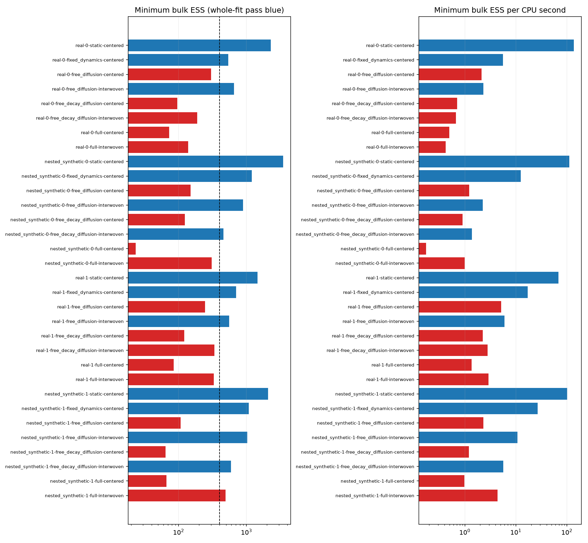

# Task 3 — dynamics isolation and innovation interweaving

28 October 2026. This follow-up preserves every preceding run. The experiment
is a bounded diagnostic pilot, not a new efficacy benchmark or Tasks 1–2 work.

**Measured outcome:** interweaving resolves the isolated free-diffusion sampling
failure on both real cohorts and both known-truth datasets, but **0/8 full-model
fits pass**. The original data anomalies can all be explained by within-day
permutations; the earlier exclusions do not identify a uniquely clean subset.
Full-model inferential claims remain unsupported. The [complete tables](results/task3-dynamics-investigation/report.md)
retain all 32 fits, every monitored scalar, recovery and CPU comparisons.

## Extract provenance and stronger integrity audit

The only local preparation evidence found is commit `7281f7f` (12 October 2026),
which introduced both Parquet files as already preprocessed data. The tracked
Python loader consumes those files; it does not create them. It concatenates
and resplits rows and uses integer `delta_t`, so its behavior cannot establish
upstream ordering or authenticate the input fields. No local preparation script,
source download fingerprint or original intra-day timestamps was located.
The audit records SHA-256, Git blob identity and Parquet writer metadata.
Writer package versions identify the writer environment, not dataset provenance.

Across 2,664,994 rows / 316,334 user/card histories, stored card-day order never
goes backwards. The combined files are globally day-sorted, and the train file
contains essentially exactly 80% of all rows. This is consistent with a global
row split after sorting by day; it does not prove the preparation algorithm.
Users have their own time origins if `timestamp` is a renamed `day_offset`,
so such a global day split would not necessarily be a shared calendar cutoff.
That renaming remains an inference, not an authenticated fact.

There are 2,348,660 adjacent card intervals, including 945,560 same-day ties.
177,986 intervals in 59,271 histories differ by more than one day between the
calendar gap and recorded elapsed seconds. Of these, calendar gaps exceed
elapsed gaps 83,238 times; the reverse occurs 94,748 times. Ordering rows by day
alone cannot explain both kinds. Plausible causes include omitted reviews,
within-day order loss and field transformations; the local files do not identify
which cause applies to a particular history. `delta_t` agrees with rounded
elapsed days for 2,592,475 rows, but is not universally that transformation.

The public [Anki Revlogs 10K schema](https://huggingface.co/datasets/open-spaced-repetition/anki-revlogs-10k)
uses `card_id`, per-user `day_offset`, `elapsed_days`, and `elapsed_seconds` and
describes chronological input order. The resemblance supports a provenance
hypothesis only. Its gated files were not accessed, licenses were not accepted,
and no claim of authenticated correspondence is made. Local state codes also
need a preparation explanation before assuming that every public-schema detail
applies unchanged.

**Correction to the earlier integrity description:** checking each adjacent gap
within one day is necessary but insufficient for a globally coherent history.
Under a day-floor interpretation, `timestamp - cumulative_elapsed_days` must
have range less than one day for some unknown initial time of day. One of the
60 selected histories fails even the tolerance-adjusted necessary check (range
1.24465 days). The existing cohort selections are preserved for matched sampler
comparisons and explicitly remain provisional. This is not a newly validated
clean dataset. Do not extend these real-data results to mechanism or efficacy
claims. The audit does not replace missing outcomes or modify the source files.

## Ordering audit: decisive follow-up

A read-only sensitivity audit sorts each card/day group with its longest elapsed
gap first (retaining days and all rows). Under this alternative order, **all
177,986 adjacent discrepancies disappear, and all 62,313 whole-history day-floor
failures disappear**. Maximum cumulative residual range falls below one day
(0.99971 days). Both selected cohorts become day-floor feasible, including the
one previously flagged card. No model input or preceding run was reordered.

This is strong evidence that loss of within-day order can explain the apparent
timing anomalies without requiring omitted between-day reviews. It supersedes
any reading of the earlier audit as evidence that those 59,271 histories must
contain missing reviews. A global sort by day using an unstable tie sort is a
plausible preparation mechanism, but no producer script was found to establish
it. The alternative permutation is an explanatory diagnostic, **not an
authenticated recovery of original chronology**: several short-gap events in
the same day can still be permuted while satisfying the timing constraints.
Their outcome order changes lag effects and cumulative practice at intermediate
events. Missing early or same-day reviews are not ruled out by feasibility.

The original adjacent-consistency selection therefore excludes histories partly
on the stored tie order. Its 1,096 eligible histories should not be described as
the uniquely clean subset of the dataset. The current inference pilot retains
those selections only to compare samplers on exactly matched inputs. Before a
broader inferential study, obtain the preparation script or the original
chronologically ordered per-user records; preserve a sequence index through
renaming/splitting. If these cannot be recovered, report order sensitivity across
feasible permutations instead of treating a gap-based sort as ground truth.
The public source remains a hypothesis; no gated files were accessed.

## Prespecified experiment

Both saved real cohorts are reused exactly, including their original provided
split points. Two new synthetic datasets reuse their nested user/card identities,
lengths and exact gap schedules while generating every outcome and latent state
anew. Practice counts and lagged outcomes are recomputed from those synthetic
outcomes. Timing is treated as fixed, exogenous design in these simulations;
actual learner schedules can be endogenous. This tests conditional-design
recovery, not an Anki scheduling simulator or prior-drawn SBC.

The ladder is static regression, latent dynamics with all OU parameters fixed,
free diffusion only, free decay plus diffusion, and the full model with free
practice dependence. Fixed real-data controls use lambda=.05/day, sigma2=.5/day,
kappa=0, chosen before observing the new fits. Synthetic controls fix the
corresponding generating values (.35, .3, .6). **Fixing parameters changes the
fitted model.** A passing control is not a sampler-only convergence win for the
full model. Full models retain every original parameter prior and support.

Every fit has four chains, 8,000 iterations / 4,000 warmup, no thinning. Both
centered and interwoven kernels use joint decay and exact coefficient blocking;
interweaving adds five joint innovation proposals per sweep. Static and fully
fixed controls are not duplicated: 32 fits / 128 analyzed chains altogether.
CPU-normalized comparisons account for the added work. This is a single timing
realization per fit on this machine, not a repeated hardware benchmark.

The unchanged gate is folded rank-normalized split R-hat <1.01, bulk ESS >=400
and tail ESS >=400 for **every monitored scalar**. Undefined fails. All original
raw effects, scales, centered effects and terminal states remain monitored;
additional combined user levels and within-user card contrasts address the
nested likelihood symmetries. The training mean-design matrices each have
37 columns but rank 33: four exact likelihood-null directions, consistent with
three nested user/card shifts plus the global offset shift. Proper priors keep
the Gaussian conditional precision full rank; they do not create likelihood
information along those directions. Fixed constants are excluded only because they
are not sampled. They remain in posterior files to support predictions.

Synthetic truth includes generating hierarchy variances and terminal training
states. The recovery table retains every available truth, including failed
parameters; no calibrated coverage claim follows from two datasets. Real data
never receive a recovery calculation. Raw offsets remain prior-allocated along
nested likelihood symmetries even if their Monte Carlo diagnostics pass.

## Innovation target and update order

After the ordinary PG -> FFBS -> coefficients/scales -> collapsed decay -> exact
diffusion update, form

`z_t = [psi_t - phi_t psi_(t-1) - (1-phi_t) mu_t] / sqrt(q_t)`.

At the first event phi=0 and q=1, preserving the original initial-state prior.
Hold z and the current PG variables fixed, propose symmetric increments in
`(log lambda, kappa, log sigma2)`, and reconstruct the entire path with the new
OU parameters. The transformed transition Gaussian determinants cancel the
triangular state Jacobian `prod sqrt(q_t)`. The standard-normal z density is
constant in this parameter-only move. The remaining likelihood is the exact PG
quadratic `sum[(r-.5) psi - omega psi²/2]`. Parameter prior terms are the original
normal priors in log lambda and kappa and `-a log sigma2 - b/sigma2` for diffusion:
the last expression includes the log-diffusion Jacobian. Bounds are unchanged.

The state and parameters are accepted together; rejected parameters and path
remain unchanged. No partially collapsed sigma2 move is added after this
transformation; the centered step already restored sigma2 before interweaving.
The next sweep refreshes PG variables from the resulting path. Proposal scale
adapts only in warmup and is frozen for retained draws. Priors, likelihood and
initial variance are unchanged by this extra transition.

[Stan's reparameterization guidance](https://mc-stan.org/docs/stan-users-guide/efficiency-tuning.html)
and [Kastner & Frühwirth-Schnatter's ASIS work](https://arxiv.org/abs/1706.05280)
motivate the hypothesis; the stochastic-volatility results do not prove this
OU logistic implementation will mix well. The implementation is experimental
and CLI-only until the matched pilot is evaluated. Hierarchy non-centering is
still a separate hypothesis; a latent-path intervention does not automatically
resolve weakly informed hierarchy scales.

## Reproduction and artifacts

From the repository root:

```sh
.venv-diagnostics/bin/python -m model_diagnostics.provenance_audit \
  --out .task3-runs/NEW-AUDIT/audit.json
OPENBLAS_NUM_THREADS=1 OMP_NUM_THREADS=1 .venv-diagnostics/bin/python \
  -m model_diagnostics.investigate --out .task3-runs/NEW-INVESTIGATION
```

The runner requires the preceding saved `task3-anki-joint_blocked` selection
and dataset files. It refuses an existing output directory. Exact datasets,
truths, split points, draw/warmup NPZs, predictions, source hashes, chain settings,
all scalar diagnostics and trace/rank/dependence figures are saved locally.
Original-ID mappings stay in the preceding ignored run; new aggregate artifacts
use dense IDs. Existing reports and run directories are not rewritten.

After computation finishes, curate and compare without changing the raw run:

```sh
.venv-diagnostics/bin/python -m model_diagnostics.investigation_report \
  --source .task3-runs/task3-dynamics-completed \
  --out experiments/results/task3-dynamics-investigation
```

Both source Parquet blobs match their committed versions. No input files or
unrelated research were changed.

The session interruption stopped computation after ten completed fits. These
were fingerprint-checked and copied unchanged into
`.task3-runs/task3-dynamics-continuation`; the remaining fits continue there.
`resume-origin.json` retains their original artifact hashes. Numerical sampler
sources and dependency versions matched before continuation. A source snapshot
and separate execution-segment labels preserve provenance. Matched centered /
interwoven CPU ratios must use fits from the same execution segment; absolute
CPU times across the interruption are not a controlled hardware comparison.
The original incomplete directory remains untouched.

A later duplicate-key bug in recovery-row export stopped the first continuation
after 14 fully checkpointed fits and one sampled full synthetic fit. The bug was
in bookkeeping, not the transition kernel. Regression tests now cover recovery
serialization and partial-fit draw verification. The final continuation is
`.task3-runs/task3-dynamics-completed`. The sampled partial fit is re-executed
with identical seeds to recover unsaved CPU metadata; its retained and warmup
arrays must match the preserved arrays exactly before proceeding. Thus the
scientific comparison uses 128 chains across 32 fits, with four additional
completed chain computations for that replay and uncounted interrupted work.
No chains are rejected or selected using diagnostic results. All preceding
directories remain unchanged; aggregate artifacts are continued in a new one.

The newly pulled Task 1 pipeline (`da37d49`) preserves original per-user file
order and first-review indicators on its own inputs. Its reported raw-data cache
is absent locally, so it does not authenticate the older `AnkiFirstRun` extract.
No Task 1 code, results or interpretation was changed by Task 3.

## Final measured results

All 32 fits are complete, with 128 analyzed chains and four additional completed
chain computations for the exact replay described above. **14/32 pass**, but
that denominator includes fixed controls which change the model. The counts
below separate those controls from full-model sampling.

| Fitted control | Centered passes / fits | Interwoven passes / fits |
|---|---:|---:|
| Static regression | 4/4 | Not duplicated |
| All dynamics parameters fixed | 4/4 | No parameter move to test |
| Free diffusion only | 0/4 | 4/4 |
| Free decay and diffusion | 0/4 | 2/4 (both synthetic) |
| Full, including free practice dependence | 0/4 | 0/4 |

| Dataset | Kernel | Max R-hat | Minimum bulk / tail ESS | Summed chain CPU seconds | Whole-fit gate |
|---|---|---:|---:|---:|---|
| Real cohort 1 | Centered | 1.05361 | 72.4 / 170.7 | 146.4 | FAIL |
| Real cohort 1 | Interwoven | 1.03800 | 139.0 / 176.1 | 328.2 | FAIL |
| Real cohort 2 | Centered | 1.04585 | 84.7 / 246.7 | 62.0 | FAIL |
| Real cohort 2 | Interwoven | 1.02077 | 329.3 / 627.6 | 112.6 | FAIL |
| Nested synthetic 1 | Centered | 1.12122 | 23.3 / 172.4 | 133.2 | FAIL |
| Nested synthetic 1 | Interwoven | 1.01576 | 307.7 / 628.9 | 308.2 | FAIL |
| Nested synthetic 2 | Centered | 1.03751 | 66.1 / 107.9 | 67.8 | FAIL |
| Nested synthetic 2 | Interwoven | 1.01006 | 491.6 / 902.9 | 112.6 | FAIL |

The last fit fails lambda's R-hat at **1.01006**. Its adequate ESS and proximity
to the threshold do not make it a pass. All raw effects, hierarchy scales,
terminal states and derived nested summaries remain in the gate; no chains or
failing parameters are removed. The added nested summaries make the monitor set
more stringent than the earlier pilot. Both centered real full fits reproduce
all 12 preceding stored parameter arrays per cohort exactly (24 arrays total).

Interwoven / centered ratios of minimum bulk ESS per CPU second are **0.86** and
**2.14** on the real cohorts, and **5.70** and **4.48** on the synthetic datasets.
There is a substantial synthetic gain and a cohort-dependent real gain, not a
universal efficiency improvement. Matched ratios use the same execution segment.
Single timing observations, test/build activity outside the benchmarked fits,
and machine-specific costs limit precision; no hardware-general claim follows.

The corresponding full-model held-out log-loss deltas (interwoven minus centered)
are -0.00157, -0.00588, -0.00026 and -0.00801. Both kernels target the same model;
these differences are prediction stability screens under imperfect mixing, not
predictive gains from a different statistical mechanism. All full fits fail.
The inherited online predictive filter remains approximate. No component ranking
or efficacy conclusion is drawn from those point scores.

### What remains slow

In real cohort 1, interwoven lambda, diffusion and kappa individually pass, yet
33 other monitored quantities fail, including card-effect variance, several card
contrasts, combined user levels and terminal states. Real cohort 2 still has 17
failures involving population/individual lag slopes, lambda, kappa and terminal
states. Nested synthetic 1 has seven failures, including kappa and mean lag
slope; nested synthetic 2 fails only lambda R-hat. Improving the diffusion block
therefore exposes different remaining location/hierarchy and decay bottlenecks.
It does not establish that the complete posterior is reliably explored.

The two synthetic datasets each provide 142 dependent known-truth summaries per
full fit, including three hierarchy variances and 30 terminal training states.
Truth-containing intervals are 136/142 and 141/142 for centered fits, and
135/142 and 141/142 for interwoven fits. Whole fits still fail. In every fit,
the true lag-slope variance .04 lies below its reported interval despite that
variance's own passing Monte Carlo gate. For example, interwoven synthetic 1
estimates .99 with interval [.217,3.548]. With only three users and the unchanged
inverse-gamma(2,1) prior, this is consistent with weak scale information and
prior sensitivity. It is not a reason to alter the prior under a sampler-only
label. Passing Monte Carlo diagnostics would not itself guarantee fixed-truth
recovery, and these few dependent intervals are not calibrated coverage or SBC.

### Decisions and next bounded work

First recover authenticated within-day order from the producer script or original
per-user files, retaining an explicit original sequence index through every sort
and split. If that is unavailable, evaluate feasible order sensitivity explicitly;
do not label a descending-gap permutation as recovered ground truth or equate
the original timing exclusions with proven missing events. The newly pulled
Task 1 loader follows a different input/preprocessing route and cannot establish
provenance for this older extract.

For sampling, keep innovation interweaving as an experimental option. The next
sampler-only hypothesis should target remaining state/location and hierarchy
coupling: a joint coefficient/latent-path move in innovation coordinates and/or
centered/non-centered hierarchy interweaving. Both require new conditional/target
checks and matched computational comparisons. More retained iterations alone
would not resolve the source-order ambiguity or the exact nested-effect symmetry.
Investigate hierarchy prior sensitivity as a separate model analysis; never
present changed priors or fixed dynamics as sampler-only convergence wins. Broader
users/cohorts and prior-drawn SBC follow these correctness and provenance checks.

## Validation and preservation

`npm run test:diagnostics` passes 21 tests; `npm run test:bayesian` passes two
Node and three Python tests. TypeScript checking and focused Biome checks pass.
The transformation tests check round-trip reconstruction, the triangular state
Jacobian, transformed parameter priors, support/rejection rollback, fixed controls
and frozen adaptation. Additional checks cover ambiguous same-day outcome order,
known-truth generation without copying observed outcomes, recovery serialization,
checkpoint preservation and exact replay of partial-fit arrays. The original
sampler/Anki tests remain in the suite.

No Task 1/2 implementations, source Parquet files, prior completed studies or
unrelated `research/` work were edited. The user-requested pull fast-forwarded
`BayesianScheduler` to `da37d49`, preserving the local changes. No push was made.
The experimental kernel and dynamics ladder remain CLI-only; the browser's
existing sampler menu is unchanged. The workspace now explains the provisional
within-day order, and specialized investigation directories are excluded from
its standard worker-study list. A fresh page after a clean development restart
had no hydration warnings. The [verified workspace screenshot](results/task3-dynamics-investigation/workspace.png)
and all aggregate audit evidence are included with the curated results.



Production build also passes. It retains the existing multiple-lockfile/workspace
root, dynamic file-tracing and Node deprecation warnings. The build ran after
all timed fits finished. Repository-wide lint retains the previously documented
unrelated failures; only the affected TypeScript files were checked here.
