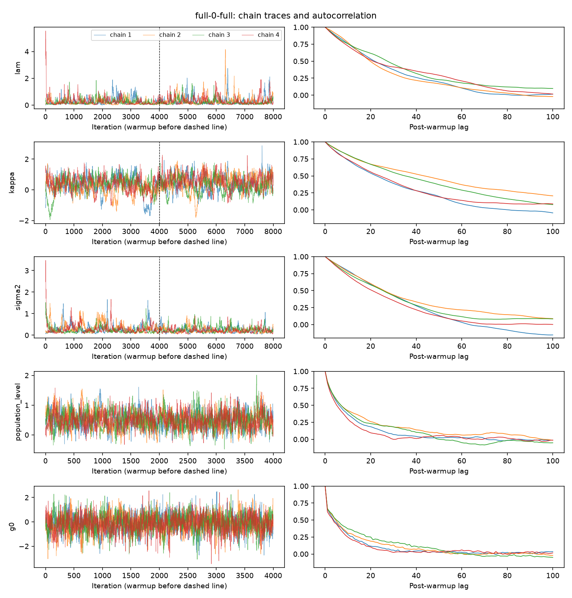
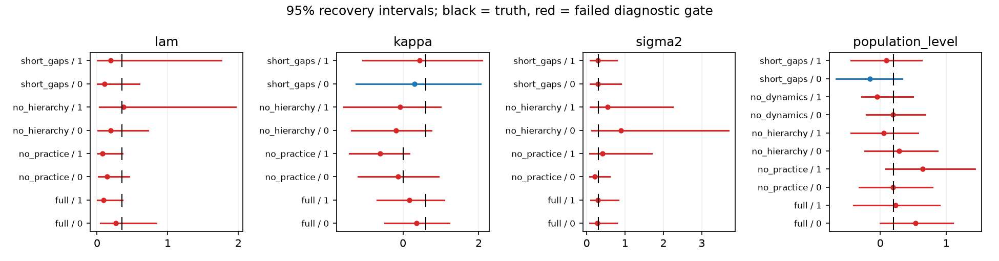

# Task 3 — observed findings, 27 October 2026

## Sampler follow-up

The subsequent 80-chain matched sampler investigation is documented in
[TASK3_SAMPLER_REPORT.md](TASK3_SAMPLER_REPORT.md), with per-fit and per-parameter
comparisons in [sampler-comparison](results/task3-sampler-comparison/report.md).
The [actual Anki follow-up](TASK3_ANKI_REPORT.md) evaluates the available real
observations separately. The initial-study evidence below is preserved as its
reference snapshot.

## Decision

The diagnostics workspace is implemented and the synthetic study is complete. The current sampler is **not ready for inferential claims** under the tested budgets. All 40 fits in the main study fail the prespecified whole-fit gate. A longer run improves mixing but still fails for both compared variants. No model component is yet empirically justified by these experiments.

## Evidence and provenance

The main study has five generating conditions, two independent datasets each, four variants and four independent chains: 160 chains, each with 2,400 iterations and 1,200 warmup. Each dataset has 640 generated outcomes, 480 training and 160 held-out events. Four worker processes run chains concurrently. These are synthetic observations, not learner measurements. The exact generator and protocol are in [RESEARCH_WORKSPACE.md](../RESEARCH_WORKSPACE.md).

The additional sensitivity run reuses the first full-model dataset and chain seeds, extends to 8,000 iterations / 4,000 warmup and fits full and no-dynamics (8 more chains). Priors and data are unchanged; the longer adaptation period means this is a fresh longer fit, not a continuation of stored chains.

Both studies use the existing pure NumPy OU model and a reference Pólya–Gamma sampler. Prior work used a truncated PG approximation and single-chain split R-hat; these runs are new evidence, not a reconstruction of an unavailable earlier chain history. Source hashes and package versions are in each provenance file.

## Predictive performance and cost

Across the ten generating datasets, these are descriptive averages. Averaging heterogeneous scenarios is not an effect estimate and must not be used to select a winning model. Every entry below includes failed fits.

| Variant | Mean held-out log loss | Mean Brier | Mean fit CPU seconds (4 chains) | Fits passing gate |
|---|---:|---:|---:|---:|
| full | 0.5910 | 0.2026 | 39.10 | 0/10 |
| no_practice | 0.5915 | 0.2028 | 33.45 | 0/10 |
| no_hierarchy | 0.6031 | 0.2074 | 36.73 | 0/10 |
| no_dynamics | 0.5996 | 0.2066 | 5.86 | 0/10 |

The no-dynamics model is cheaper, but that does not establish equal predictive performance. Individual full-generating datasets disagree about its predictive ranking. For full data replicate 1, removing dynamics changes log loss by −0.0081 (95% paired user-cluster interval −0.0343 to 0.0158); replicate 2 changes it by +0.0086 (−0.0176 to 0.0347). Both intervals span zero and all involved fits fail diagnostics.

The main study took 470.1 elapsed seconds including analysis and figures. CPU cost is summed process CPU over four chains, not wall latency. Costs are hardware-specific. Prediction times are recorded separately.

## Longer-chain sensitivity

| Fit | Iterations / warmup | Max R-hat | Minimum bulk ESS | Minimum tail ESS | Failed parameters |
|---|---|---:|---:|---:|---:|
| full | 2400 / 1200 | 1.1247 | 27.6 | 70.3 | 21 |
| no_dynamics | 2400 / 1200 | 1.0310 | 132.5 | 202.9 | 10 |
| full | 8000 / 4000 | 1.0401 | 155.2 | 280.4 | 5 |
| no_dynamics | 8000 / 4000 | 1.0049 | 385.7 | 589.7 | 1 |

The static ablation nearly passes the longer-run gate but its minimum bulk ESS (385.7) remains below 400. The full model still has five failing scalar diagnostics. Longer chains help; they have not resolved the problem.

For the full first dataset, parameter-specific diagnostics improve as follows:

| Parameter | Short-run R-hat / bulk ESS | Longer-run R-hat / bulk ESS | Longer-run mean [95% interval] | Truth |
|---|---|---|---|---:|
| lam | 1.093 / 66.5 | 1.020 / 185.5 | 0.281 [0.032, 1.092] | 0.35 |
| kappa | 1.059 / 57.8 | 1.040 / 155.2 | 0.408 [-0.582, 1.345] | 0.6 |
| sigma2 | 1.125 / 27.6 | 1.023 / 255.5 | 0.229 [0.079, 0.563] | 0.3 |
| population_level | 1.014 / 242.2 | 1.002 / 667.7 | 0.503 [-0.002, 1.066] | 0.2 |

All four intervals contain their known truth, but that does not validate the chain or prove accurate estimation. The kappa interval includes zero. The broad decay/diffusion intervals and low ESS preclude a precise interpretation.

## Identifiability and ablation conclusions

| Component | Evidence from this run | Research decision |
|---|---|---|
| Latent dynamics | Predictive direction changes across full-generating datasets; diffusion and decay mix slowly. Removing the full dynamics block greatly reduces cost. | Keep as a hypothesis; isolate persistence versus diffusion in a future additional ablation after improving sampling. |
| Practice-dependent decay | No consistent full-data predictive gain; first full-data kappa interval spans zero even after longer sampling. Posterior lambda–kappa correlation is 0.62 in the longer fit. | Weakly separated in this design; require broader practice ranges, more replicated datasets and converged inference. |
| Hierarchical effects | Removing them often worsens point log loss, including when true user/item effects are zero. This ablation also removes slope variation, and full inference has not converged. | Do not claim hierarchy validated. Separate random intercepts from random slopes, investigate prior sensitivity and partial pooling with more users/items. |

The likelihood contains b0+alpha_user+beta_item. Additive shifts between these terms leave likelihood predictions unchanged; proper priors regularize, rather than identify these terms from data. The combined population level and centered effect contrasts are more interpretable than raw offsets. In the longer first full fit, population_level has R-hat 1.002 and bulk ESS 667.7, while raw b0 has bulk ESS 322.6. This is consistent with weak separation along additive directions, not proof that every convergence failure has that cause.

Time-scale identifiability is a separate problem: log(rate)=log(lambda)−kappa log(1+successes). Short gaps and narrow practice ranges cannot strongly distinguish lambda and kappa. The short-gap stress test reaches full-model maximum R-hat 1.994. A large R-hat identifies sampling disagreement, not by itself structural non-identifiability.

## Recovery limits

Matched models yield 234 dependent parameter intervals over the main study; only 106 pass their parameter-specific gate. This must not be described as 234 independent recovery trials. Replicate-level bias, RMSE, coverage and convergence counts are available in recovery-summary.csv. The few seeds and failed whole-fit gates do not establish calibrated 95% coverage. Misspecified variants are marked explicitly; uploaded data never generate recovery estimates.

## Next experiments

1. Improve the sampler before expanding predictive claims: jointly propose lambda/kappa or decay/diffusion; investigate a non-centered or blocked population/effect update. These changes are not implemented here.
2. Re-run the matched study with more retained draws and inspect every scalar gate, not only lambda. Keep the current settings/results as a regression reference.
3. Separate dynamics persistence from diffusion, and hierarchical intercepts from slopes, rather than treating each block as an indivisible benefit.
4. Extend the synthetic design over users/items, gaps, practice range and signal/noise, then run prior-drawn simulation-based calibration. Two seeds per condition are a pilot.
5. Evaluate the frozen variants on real chronological learner data only after sampling and identifiability checks are satisfactory. The supplied processed pickle is not used as efficacy evidence in this synthetic study.

## Saved artifacts

- [Main technical report](results/task3-study/report.md)
- [Main predictive results](results/task3-study/results.csv)
- [Per-parameter diagnostics](results/task3-study/diagnostics.csv)
- [Ablation comparisons](results/task3-study/ablations.csv)
- [Recovery bias/RMSE/coverage](results/task3-study/recovery-summary.csv)
- [Longer-chain technical report](results/task3-longer-chains/report.md)

All raw posterior/warmup draws, generated data and additional plots remain in ignored `.task3-runs/` and are downloadable from the local workspace. Curated synthetic plots/tables and provenance are retained alongside this report.

Diagnostic thresholds follow [Stan guidance](https://mc-stan.org/learn-stan/diagnostics-warnings.html); rank-based diagnostics are computed with [ArviZ](https://python.arviz.org/en/v0.23.4/api/generated/arviz.rhat.html).
