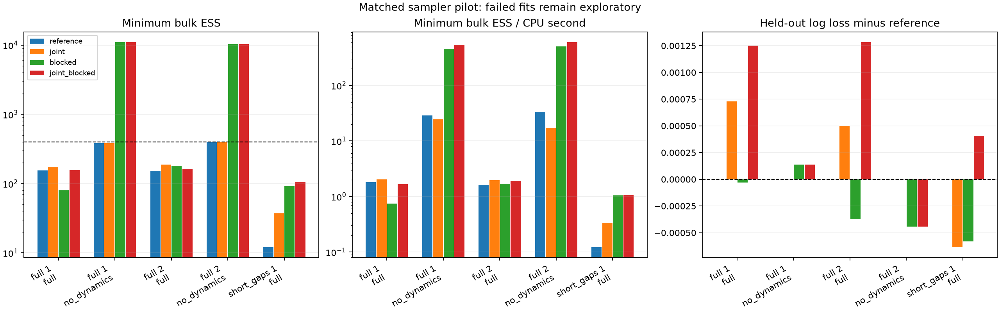

# Task 3 sampler remedies — 27 October 2026

Coefficient blocking resolves the static model's convergence bottleneck on both
ordinary datasets, with roughly 15–16× minimum ESS per CPU second. The full
model still fails in all 12 matched fits; diffusion remains the main bottleneck.
All changes preserve the statistical model, priors and diagnostic thresholds.

The real-observation follow-up is documented separately in
[TASK3_ANKI_REPORT.md](TASK3_ANKI_REPORT.md).

## Scope and conditional audit

This investigation changes the transition kernel only. The OU likelihood, PG
augmentation, first-state variance, parameter support and all priors remain
unchanged. The original implementation and saved reference results are untouched.
The new implementations live in `model_diagnostics/model.py`; they default to
`reference` for backwards compatibility. Tasks 1 and 2 are outside this work.

For fixed latent states and dynamic parameters, write
`y_t = psi_t - phi_t psi_(t-1)`, `c_t = 1-phi_t` and `v_t = q_t`.
Then `y_t ~ N(c_t (b0+alpha_u+beta_i+gamma_u x_t), v_t)`.
At the first event phi=0 and q=1. The reference scalar Gaussian conditionals
match these weighted regressions, including the first-state term. Group variance
updates have shape `2+n/2` and scale `1+sum(effect-center)^2/2`.
The population slope conditional uses the gamma effects and its N(0,100) prior.
There is no hard sum-to-zero constraint; posterior centering is post-processing.

For transition rows only (the first variance is independent of sigma2), write
`q_t = sigma2 h_t` and residual `e_t = psi_t-phi_t psi_(t-1)-c_t mu_t`.
Integrating sigma2 ~ IG(a,b) gives log density
`-sum(log(h_t))/2 - (a+n/2) log(b+sum(e_t²/h_t)/2)` plus parameter priors.
A random walk in log(lambda) needs the Gaussian log-lambda prior density with
respect to d log(lambda); no extra lambda Jacobian belongs in that coordinate.
Kappa has its existing truncated N(0,1) prior on (-3,3). Both scalar reference
moves leave this collapsed target invariant. Sigma2 must be restored immediately
from IG(a+n/2,b+sum(e_t²/h_t)/2), before any update conditioning on sigma2.
The existing order does that: PG → FFBS → effects/hypervariances → collapsed
lambda/kappa → sigma2. No conditional or ordering defect was found in this audit.
This is a source and algebra audit supported by conditional tests, not a general
proof of the entire implementation.

FFBS performs the Gaussian forward/backward conditional after PG augmentation.
For unequal sequence lengths, backward recursion restarts at each sequence's last
observed event; padded events do not feed back into its retained states. PG draws
condition on psi, so the following parameter transitions do not require fresh PG
variables until the next sweep. Static fits use PG weighted logistic regression.

## Implemented hypotheses

- `joint`: five bivariate random-walk MH proposals per sweep for
  `(log(lambda), kappa)`, with sigma2 integrated out. Welford empirical covariance
  updates begin after 50 warmup sweeps, shrunk 5% toward diag(0.2²,0.15²).
  A scalar multiplier adapts toward 0.234 acceptance, bounded [0.01,10].
  Both covariance and multiplier freeze at warmup; retained samples never adapt.
  Covariance and scale are held fixed within each five-proposal sweep.
  The target includes both priors and rejects unsupported parameters.
  No-practice fits use the reference scalar lambda transition; static fits have
  no decay transition. Acceptance is a tuning diagnostic, not convergence evidence.
- `blocked`: jointly draws `[b0,alpha,beta,gamma,g0]` from the exact Gaussian
  conditional using precision `P_prior + X' diag(1/q) X` and information
  `X' diag(1/q) y`. The hierarchical gamma-g0 prior contributes cross precision
  terms `-1/tau_gamma²` and the g0 diagonal contribution `n_users/tau_gamma²`.
  A Cholesky solve draws correlated coefficients without imposing constraints.
  Hypervariances follow this block via the same inverse-gamma conditionals.
  No-hierarchy fits jointly draw their two population coefficients instead.
- `joint_blocked`: combines the preceding two kernels. It adds no new model term.

The number of MH proposals is configurable from 1–20, default five in every
comparison. This is five target evaluations for the joint sweep versus five
lambda and five kappa proposals in the reference sweep, not equal target-evaluation
work. CPU-normalized ESS reports that computational tradeoff explicitly.
Dense Gaussian blocking is practical here (15 coefficients for 4 users/5 items);
its cost/scaling must be reassessed for substantially larger designs.

Tests compare Gaussian block draws to analytic means/covariances and independently
finite-difference the log joint density to check its precision. They compare
collapsed log-density ratios with the normalized inverse-gamma integral and
verify frozen post-warmup adaptation. These checks target correctness, not an
assumed improvement in convergence.

## Matched protocol

Four sampler choices × (two ordinary-gap datasets with full/static fits plus one
short-gap dataset with a full fit) × four chains = **80 new chains, 20 fits**.
Each uses 8,000 iterations, 4,000 warmup, no thinning, the original seeds, crossed
4-user/5-item design, 32 events per pair, and 25% chronological holdout. The first
ordinary dataset matches the saved longer-chain study exactly. The stress case
matches the first original short-gap dataset. All configurations are saved under
`experiments/task3-remedy-*.json`. Raw runs use new `.task3-runs/task3-remedy-*`
directories. OpenBLAS and OpenMP thread counts are one for all new studies;
fit CPU is summed across four processes. Wall times include analysis/plotting and
are not sampler CPU measurements. Costs remain hardware/load dependent.

The fixed gate remains rank-normalized folded split R-hat <1.01 and bulk/tail ESS
>=400 for every monitored scalar, including effect contrasts and terminal states.
An unchanged reference rerun provides contemporary CPU measurements as well as
checking equality with saved retained draws. Two independent ordinary datasets
and one stress dataset are a pilot; no calibrated coverage or learner efficacy
claim follows. Predictions retain the existing approximate prequential filter.

## Measured results

**No full-model fit passes** (0/12 across the four kernels and three datasets).
Blocked static fits pass on both ordinary datasets; the reference static kernel
passes on one of the two. Counting all runs gives 6/20 passing fits, but these
are not 20 independent replications. Joint has no effect in static fits:
reference/joint static draws are identical, as are blocked/joint_blocked static
draws. The 80 computed chains contain 64 distinct trajectories; the static
controls provide two datasets, not four independent sampler replications.

| Dataset / fitted model | Sampler | Max R-hat | Min bulk / tail ESS | Min bulk ESS / CPU s | CPU s | Log loss | Brier | Gate |
|---|---|---:|---:|---:|---:|---:|---:|---|
| full 1 / full | reference | 1.0401 | 155.2 / 280.4 | 1.83 | 85.0 | 0.61457 | 0.21292 | FAIL |
| full 1 / no_dynamics | reference | 1.0049 | 385.7 / 589.7 | 28.71 | 13.4 | 0.60420 | 0.20735 | FAIL |
| full 2 / full | reference | 1.0336 | 152.8 / 238.2 | 1.61 | 94.8 | 0.63674 | 0.22313 | FAIL |
| full 2 / no_dynamics | reference | 1.0059 | 401.7 / 775.8 | 33.21 | 12.1 | 0.64425 | 0.22688 | PASS |
| short_gaps 1 / full | reference | 1.3058 | 12.0 / 18.7 | 0.12 | 98.8 | 0.62012 | 0.21639 | FAIL |
| full 1 / full | joint | 1.0201 | 170.9 / 302.9 | 2.03 | 84.2 | 0.61530 | 0.21328 | FAIL |
| full 1 / no_dynamics | joint | 1.0049 | 385.7 / 589.7 | 24.58 | 15.7 | 0.60420 | 0.20735 | FAIL |
| full 2 / full | joint | 1.0276 | 187.7 / 285.9 | 1.96 | 95.8 | 0.63724 | 0.22336 | FAIL |
| full 2 / no_dynamics | joint | 1.0059 | 401.7 / 775.8 | 16.92 | 23.7 | 0.64425 | 0.22688 | PASS |
| short_gaps 1 / full | joint | 1.0968 | 37.1 / 40.7 | 0.34 | 110.7 | 0.61948 | 0.21606 | FAIL |
| full 1 / full | blocked | 1.0577 | 80.3 / 335.9 | 0.74 | 108.6 | 0.61454 | 0.21297 | FAIL |
| full 1 / no_dynamics | blocked | 1.0008 | 11028.6 / 11866.9 | 456.30 | 24.2 | 0.60434 | 0.20745 | PASS |
| full 2 / full | blocked | 1.0206 | 180.8 / 372.6 | 1.70 | 106.5 | 0.63637 | 0.22300 | FAIL |
| full 2 / no_dynamics | blocked | 1.0005 | 10353.8 / 12217.1 | 506.83 | 20.4 | 0.64381 | 0.22670 | PASS |
| short_gaps 1 / full | blocked | 1.0548 | 92.1 / 216.8 | 1.05 | 88.1 | 0.61954 | 0.21617 | FAIL |
| full 1 / full | joint_blocked | 1.0225 | 156.6 / 329.2 | 1.68 | 93.3 | 0.61583 | 0.21347 | FAIL |
| full 1 / no_dynamics | joint_blocked | 1.0008 | 11028.6 / 11866.9 | 542.13 | 20.3 | 0.60434 | 0.20745 | PASS |
| full 2 / full | joint_blocked | 1.0169 | 162.7 / 397.0 | 1.91 | 85.0 | 0.63803 | 0.22368 | FAIL |
| full 2 / no_dynamics | joint_blocked | 1.0005 | 10353.8 / 12217.1 | 602.70 | 17.2 | 0.64381 | 0.22670 | PASS |
| short_gaps 1 / full | joint_blocked | 1.0365 | 107.0 / 112.2 | 1.07 | 100.4 | 0.62053 | 0.21663 | FAIL |

For the static fits, coefficient blocking increases minimum bulk ESS from 386/402
to 11,029/10,354, and minimum bulk ESS per CPU second by about 15–16 times
(`blocked` versus contemporary `reference`). The first dataset's static b0
bottleneck is removed. This demonstrates a sampling problem in the old sequential
coefficient updates. It does not make individual raw offsets likelihood-identified.
The static model is misspecified for these full-generating datasets, so these
fits validate mixing behavior rather than matched parameter recovery.

For full fits, improvements depend on parameter and dataset. Joint proposals
improve lambda/kappa mixing but leave diffusion slow. Blocking alone improves
b0 bulk ESS from 323 to 6,151 on the first dataset, while sigma2 bulk ESS worsens
from 256 to 80. Combining kernels yields b0 ESS 5,422 and lambda ESS 473;
kappa narrowly fails (R-hat 1.01028, bulk ESS 395.8), and diffusion fails clearly
(R-hat 1.02249, bulk ESS 156.6). The second combined fit fails only sigma2
(R-hat 1.01690, bulk ESS 162.7, tail ESS 397.0). The combined short-gap fit also
fails only sigma2 (R-hat 1.03653, bulk ESS 107.0, tail ESS 112.2).
No rounding or near-threshold result is treated as passing.

The combined kernel's minimum bulk ESS/CPU ratios relative to reference are
about 0.92, 1.19 and 8.79 for ordinary dataset 1, ordinary dataset 2 and the
short-gap dataset. The stress improvement is substantial but still leaves an
unusable fit. There is no universal full-model efficiency win at this budget.
CPU timings vary even for identical static trajectories: compare reference/joint
and blocked/joint_blocked controls. Build/test activity overlapped parts of these
runs, so small timing differences are not reliable hardware benchmark evidence.

## Recovery, posterior agreement and identification

The following matched full-model recovery rows each include 29 dependent scalar
quantities, including centered contrasts and population summaries. Coverage counts
include parameters failing diagnostics and must not be read as calibrated 95%
coverage. Mixed-scale RMSE is descriptive; individual parameter errors are in
recovery.csv. All whole fits fail regardless of parameter-level passing counts.

| Dataset | Sampler | Mixed-scale recovery RMSE | Intervals containing truth / 29 | Parameters passing gate / 29 |
|---|---|---:|---:|---:|
| full 1 | reference | 0.399 | 29 | 24 |
| full 2 | reference | 0.921 | 29 | 18 |
| short_gaps 1 | reference | 0.485 | 29 | 19 |
| full 1 | joint | 0.393 | 29 | 25 |
| full 2 | joint | 0.903 | 28 | 20 |
| short_gaps 1 | joint | 2.275 | 29 | 21 |
| full 1 | blocked | 0.403 | 29 | 26 |
| full 2 | blocked | 0.941 | 28 | 26 |
| short_gaps 1 | blocked | 0.313 | 29 | 28 |
| full 1 | joint_blocked | 0.407 | 29 | 27 |
| full 2 | joint_blocked | 0.907 | 28 | 28 |
| short_gaps 1 | joint_blocked | 0.406 | 29 | 28 |

First ordinary dataset, combined kernel (all intervals remain exploratory):

| Parameter | Truth | Mean | 95% interval | R-hat | Bulk / tail ESS | Gate |
|---|---:|---:|---|---:|---:|---|
| b0 | 0.2 | 0.515 | [-0.600, 1.669] | 1.00036 | 5421.7 / 9367.3 | PASS |
| lam | 0.35 | 0.260 | [0.032, 1.031] | 1.00574 | 473.3 / 487.0 | PASS |
| sigma2 | 0.3 | 0.238 | [0.076, 0.597] | 1.02249 | 156.6 / 329.2 | FAIL |
| kappa | 0.6 | 0.356 | [-0.693, 1.361] | 1.01028 | 395.8 / 442.8 | FAIL |
| population_level | 0.2 | 0.517 | [-0.010, 1.072] | 1.00185 | 1585.4 / 3392.9 | PASS |

The combined first-dataset kappa interval still includes zero, and lambda spans
roughly a factor of 32. Better intercept mixing has not supplied information
that separates practice-dependent decay from diffusion. To quantify posterior
ridges, the following are pooled draw correlations; failed-chain correlations
are descriptive and can themselves be unstable.

| Dataset | Sampler | corr(log lambda, kappa) | corr(log lambda, log sigma2) |
|---|---|---:|---:|
| full 1 | reference | 0.772 | 0.186 |
| full 2 | reference | 0.704 | 0.433 |
| short_gaps 1 | reference | 0.291 | -0.033 |
| full 1 | joint | 0.804 | 0.212 |
| full 2 | joint | 0.659 | 0.433 |
| short_gaps 1 | joint | 0.275 | -0.009 |
| full 1 | blocked | 0.799 | 0.150 |
| full 2 | blocked | 0.622 | 0.449 |
| short_gaps 1 | blocked | 0.280 | 0.049 |
| full 1 | joint_blocked | 0.770 | 0.266 |
| full 2 | joint_blocked | 0.644 | 0.437 |
| short_gaps 1 | joint_blocked | 0.275 | 0.031 |

All four kernels preserve the same posterior. Held-out log-loss changes versus
the matched reference are small (absolute maximum below 0.0013 across all fits),
without a consistent direction. This is a posterior prediction stability check,
not evidence that changing the sampler improves the statistical model. Failed
mixing prevents using these differences as predictive rankings. Exact comparison
values, Brier deltas, CPU ratios and per-parameter MCSE screens are in the
[comparison tables](results/task3-sampler-comparison/report.md).

The data depend on b0+alpha+beta, so shifts between these offsets are exactly
likelihood-invariant. Proper priors determine their allocation. Exact blocking
moves efficiently along those directions while preserving broad uncertainty.
Raw b0, even with thousands of effective draws, is not separately identified by
the likelihood. Centered group contrasts and combined population level are more
interpretable summaries.

The decay/practice/diffusion problem is different. Short gaps make phi close to
one and reduce information about mean reversion; gamma's lag effect then enters
through a small (1-phi) multiplier. The first-state data do not identify that lag
slope because the initial lag is zero. The original scalar and joint-only kernels
show strong slope drift under that design. Blocked slopes mix much better, yet
sigma2 still fails. Broad intervals, posterior dependence and failed diagnostics
support weak practical separation, but these runs do not prove structural
non-identifiability of the entire OU block. A profile likelihood, prior-sensitivity
study and larger/richer designs are needed to distinguish those possibilities.
High R-hat alone cannot make that distinction.

## Non-centered parameterizations and next decisions

A non-centered hierarchy would write alpha=sqrt(tau2_alpha) z_alpha, similarly
for beta, and gamma=g0+sqrt(tau2_gamma) z_gamma with standard-normal z. It can
preserve priors, but the variance conditionals would change and need a separately
validated kernel. We did **not** implement or silently substitute that change.
In the combined ordinary fits, the learned hierarchy scales already pass; the
first fit's scale bulk ESS values are approximately 9,539/5,190/7,447. Blocking
also resolves the static and raw-offset mixing problems. That evidence does not
make non-centering the hierarchy the first remedy for the remaining bottleneck.
This is a prioritization decision, not proof that non-centering cannot help.

The remaining failure is concentrated in diffusion and its coupling to latent
trajectories, with near-threshold kappa on one dataset. A next sampler-only
investigation should test innovation/non-centered latent states or an interwoven
centered/innovation update, and joint decay/diffusion moves. Preserve the initial
state variance and transformed-density terms carefully. Do not change the current
inverse-gamma priors or force positivity of kappa as an unlabelled sampler fix.
Separate prior sensitivity and richer gap/practice designs from sampler remedies.
Repeat over substantially more datasets before calibrated recovery/SBC claims.

## Provenance, artifacts and validation

Both first-dataset reference fits reproduce the saved longer-chain posterior
arrays **exactly** for every retained parameter. Existing main/longer studies
and unrelated `research/` work were preserved. No changes were pushed.
New raw chain and warmup arrays remain in ignored `.task3-runs/task3-remedy-*`;
curated configs, datasets, truths, source hashes, package versions, seeds, chain
metadata, tables and selected figures are in `experiments/results/task3-remedy-*`.
The comparison tool checks matching dataset hashes and sampling/design settings
and refuses to overwrite an existing comparison directory.

The legacy metadata field `lambda_acceptance` means joint proposal acceptance
for joint kernels; `kappa_sweep_move_fraction` remains the fraction of sweeps with
a net kappa change, not an acceptance rate. Final covariance, scale and adaptation
count are saved per chain; active joint kernels report exactly 4,000 adapting
sweeps. No-dynamics has no active decay adaptation.

Workspace changes expose the four kernels and 1–20 MH proposals/sweep, keep
reference defaults for older configs, and show descriptive run IDs/settings.
Manual verification also found a stale busy state when viewing a completed study
while another study finished. Polling now continues while any listed run is active.

Validation: `npm run test:diagnostics` (10 tests), `npm run test:bayesian`
(2 Node tests and 3 Python tests), `npm run typecheck`, focused Biome checks on
the three changed TypeScript/TSX files, and `npm run build` pass. Repository-wide
`npm run lint` remains failing: 280 errors and 240 warnings across 150 files,
including pre-existing seed-script and unrelated application issues. No broad
formatting or unrelated fixes were applied. The build reports existing workspace
root/file-tracing and Node deprecation warnings.

Manual browser checks cover `/` and `/bayesian-demo`, kernel/proposal selection,
launching a new small synthetic combined-kernel study, persisted selection and
reloading its exact settings, diagnostic filtering, report rendering and artifact
links. Run `7e26d97a-af73-4292-8038-5b19cc02aecb` is an intentionally short UI
smoke test (200 iterations/100 warmup, three MH proposals); it is excluded from
the 80-chain scientific comparison. A second 800/400 smoke study checks that
viewing a completed study during a running one does not leave the launch button
permanently disabled. Comparison folders are excluded from the study list;
underscores in descriptive CLI run IDs are accepted without allowing path
separators. This makes the saved combined-kernel studies accessible in the UI.

