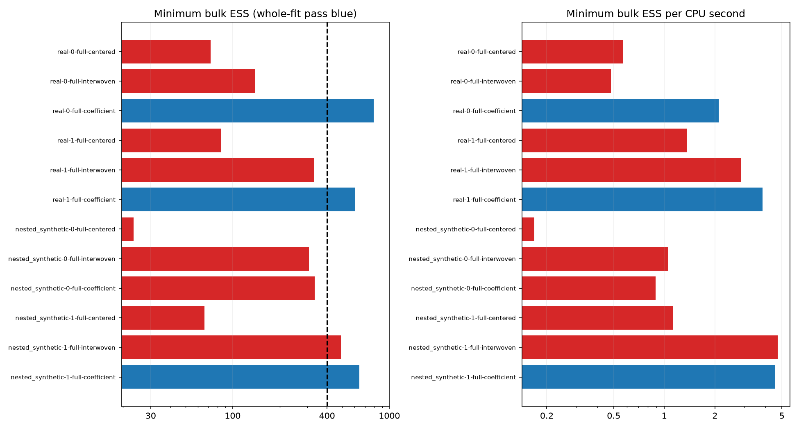

# Coefficient/path pilot: measured results

All fits use the same full model, unchanged priors, four chains and 8000/4000 iterations/warmup, no thinning. Every one of 142 monitors must satisfy finite rank-normalized folded split Rhat <1.01 and bulk/tail ESS >=400. Real cohorts retain provisional recorded order; nested synthetic recovery conditions on fixed gaps and fixed truths, not SBC.

| Dataset / cohort | Kernel | Max Rhat | Min bulk / tail ESS | Failures / monitors | CPU s | ESS / CPU s | Log loss | Gate |
|---|---|---:|---:|---:|---:|---:|---:|---|
| real / 1 | centered | 1.053610 | 72.4 / 170.7 | 46 / 142 | 127.8 | 0.567 | 0.43571 | FAIL |
| real / 1 | interwoven | 1.038000 | 139.0 / 176.1 | 33 / 142 | 287.9 | 0.483 | 0.43414 | FAIL |
| real / 1 | coefficient | 1.003671 | 793.5 / 1849.5 | 0 / 142 | 376.2 | 2.109 | 0.43355 | PASS |
| real / 2 | centered | 1.045854 | 84.7 / 246.7 | 39 / 142 | 62.2 | 1.361 | 0.58228 | FAIL |
| real / 2 | interwoven | 1.020770 | 329.3 / 627.6 | 17 / 142 | 114.9 | 2.867 | 0.57640 | FAIL |
| real / 2 | coefficient | 1.007600 | 600.8 / 637.9 | 0 / 142 | 156.8 | 3.831 | 0.57647 | PASS |
| nested_synthetic / 1 | centered | 1.121224 | 23.3 / 172.4 | 27 / 142 | 138.6 | 0.168 | 0.60510 | FAIL |
| nested_synthetic / 1 | interwoven | 1.015763 | 307.7 / 628.9 | 7 / 142 | 293.6 | 1.048 | 0.60485 | FAIL |
| nested_synthetic / 1 | coefficient | 1.005704 | 333.4 / 1119.9 | 1 / 142 | 375.3 | 0.889 | 0.60634 | FAIL |
| nested_synthetic / 2 | centered | 1.037506 | 66.1 / 107.9 | 29 / 142 | 58.6 | 1.128 | 0.58848 | FAIL |
| nested_synthetic / 2 | interwoven | 1.010056 | 491.6 / 902.9 | 1 / 142 | 104.1 | 4.721 | 0.58047 | FAIL |
| nested_synthetic / 2 | coefficient | 1.007968 | 641.5 / 1502.5 | 0 / 142 | 140.4 | 4.570 | 0.57887 | PASS |

## Matched comparisons

Ratios use contemporary baseline reruns in the same execution segment. Minimum ESS may refer to different limiting scalars. All per-parameter ESS/CPU ratios and descriptive combined-MCSE screens are retained. No failed chains or parameters are removed. Timing is a single realization per fit, not a repeated hardware benchmark.

| New fit | Baseline | ESS / CPU ratio | CPU ratio | Delta log loss |
|---|---|---:|---:|---:|
| real-0-full-coefficient | centered | 3.72 | 2.94 | -0.00216 |
| real-0-full-coefficient | interwoven | 4.37 | 1.31 | -0.00059 |
| real-1-full-coefficient | centered | 2.81 | 2.52 | -0.00581 |
| real-1-full-coefficient | interwoven | 1.34 | 1.37 | +0.00007 |
| nested_synthetic-0-full-coefficient | centered | 5.28 | 2.71 | +0.00124 |
| nested_synthetic-0-full-coefficient | interwoven | 0.85 | 1.28 | +0.00149 |
| nested_synthetic-1-full-coefficient | centered | 4.05 | 2.39 | -0.00961 |
| nested_synthetic-1-full-coefficient | interwoven | 0.97 | 1.35 | -0.00160 |

## Recovery

Counts include every dependent truth summary, including failing parameters. Few fixed-truth intervals are not calibrated coverage.

| Fit | Truth-containing intervals / 142 | Parameter passes | Whole fit |
|---|---:|---:|---|
| nested_synthetic-0-full-centered | 136 / 142 | 115 | False |
| nested_synthetic-0-full-coefficient | 135 / 142 | 141 | False |
| nested_synthetic-0-full-interwoven | 135 / 142 | 135 | False |
| nested_synthetic-1-full-centered | 141 / 142 | 113 | False |
| nested_synthetic-1-full-coefficient | 141 / 142 | 142 | True |
| nested_synthetic-1-full-interwoven | 141 / 142 | 141 | False |

## Remaining failures of the new kernel

- real-0-full-coefficient: none.
- real-1-full-coefficient: none.
- nested_synthetic-0-full-coefficient: kappa.
- nested_synthetic-1-full-coefficient: none.

## Correctness and limits

All 128 saved parameter arrays (retained and available warmup) match the preceding baseline study exactly. Every new fit retains the complete baseline monitor set. Warmup adaptation and the expected 8000 extra coefficient moves per chain are checked. The baseline replay is a regression check, not independent data replication. Independent conditional-density and transformation tests establish the extra Gibbs target.

Predictions use the inherited approximate prequential filter and at most 200 posterior draws per chain. All kernels target the same posterior; score differences are prediction-stability screens, not statistical model improvements or component efficacy. Nonconvergence limits interpretation of means, recovery and MCSE screens. Real chronology and early-history authenticity remain unresolved. Exact nested user/card likelihood symmetries are unchanged. Hierarchy priors and scale sensitivity are separate from Monte Carlo convergence.

