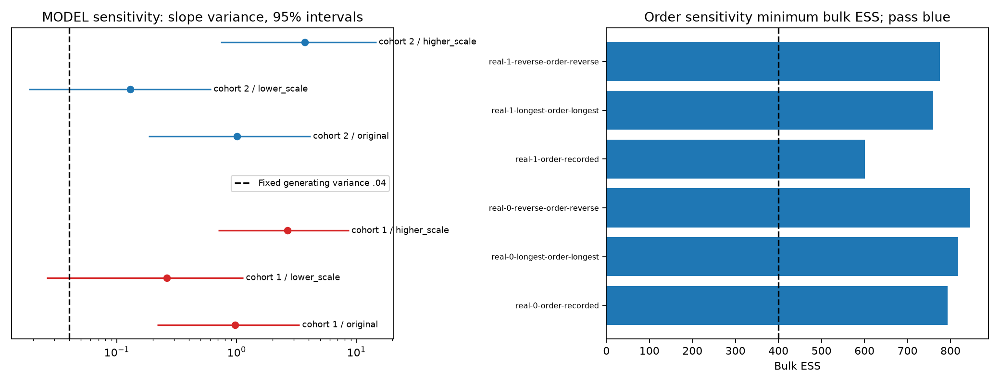

# Task 3 completion sensitivity: measured results

All 12 fits / 48 chains finished at the prespecified 8000/4000 budget with no thinning. Four unchanged references replay all 64 retained/available-warmup parameter arrays exactly. Each fit retains all 142 original scalar gates. Blue figure markers indicate whole-fit passes; red marks failures.

| Analysis / cohort | Condition | Max Rhat | Min bulk / tail ESS | Failures / 142 | CPU s | Log loss | Brier | Gate |
|---|---|---:|---:|---:|---:|---:|---:|---|
| order / 1 | recorded | 1.003671 | 793.51 / 1849.51 | 0 | 351.9 | 0.433554 | 0.134469 | PASS |
| order / 1 | longest | 1.004065 | 818.02 / 1553.74 | 0 | 384.4 | 0.462435 | 0.148100 | PASS |
| order / 1 | reverse | 1.002928 | 845.96 / 1649.99 | 0 | 381.2 | 0.430961 | 0.133504 | PASS |
| order / 2 | recorded | 1.007600 | 600.78 / 637.90 | 0 | 147.0 | 0.576472 | 0.161450 | PASS |
| order / 2 | longest | 1.007159 | 759.30 / 688.99 | 0 | 146.9 | 0.581020 | 0.161136 | PASS |
| order / 2 | reverse | 1.003601 | 775.08 / 800.53 | 0 | 148.8 | 0.581317 | 0.161456 | PASS |
| MODEL / 1 | original | 1.005704 | 333.45 / 1119.91 | 1 | 372.6 | 0.606340 | 0.211862 | FAIL |
| MODEL / 1 | lower_scale | 1.011436 | 382.70 / 702.47 | 1 | 382.7 | 0.611994 | 0.213327 | FAIL |
| MODEL / 1 | higher_scale | 1.025020 | 351.37 / 591.43 | 8 | 381.9 | 0.605907 | 0.212323 | FAIL |
| MODEL / 2 | original | 1.007968 | 641.51 / 1502.50 | 0 | 141.5 | 0.578870 | 0.197115 | PASS |
| MODEL / 2 | lower_scale | 1.007502 | 454.06 / 1186.54 | 0 | 144.2 | 0.560552 | 0.189046 | PASS |
| MODEL / 2 | higher_scale | 1.007654 | 646.23 / 727.73 | 0 | 141.9 | 0.589849 | 0.201890 | PASS |

## Feasible-order posterior impact

Changed priors/orders define sensitivity targets, not sampler benefits. Recorded order is a reproducible reference, not authenticated truth. MCSE units are descriptive screens from quadrature of marginal mean MCSEs (shared seeds can correlate fits), not significance tests or multiplicity-adjusted evidence. Whole-fit failures limit every downstream interpretation. Terminal-state targets can refer to different final events.

| Cohort | Parameter | Reverse minus longest mean | Combined MCSE | Descriptive MCSE units | Both full gates |
|---|---|---:|---:|---:|---|
| 1 | tau2_gamma | -0.01050 | 0.01027 | 1.02 | True |
| 1 | lam | +0.01198 | 0.00782 | 1.53 | True |
| 1 | sigma2 | +0.02643 | 0.00558 | 4.74 | True |
| 1 | kappa | -0.02119 | 0.02171 | 0.98 | True |
| 1 | population_level | -0.09148 | 0.01577 | 5.80 | True |
| 1 | gamma_mean | +0.12073 | 0.01573 | 7.68 | True |
| 2 | tau2_gamma | +0.01405 | 0.01120 | 1.25 | True |
| 2 | lam | -0.05260 | 0.02134 | 2.46 | True |
| 2 | sigma2 | -0.00445 | 0.00777 | 0.57 | True |
| 2 | kappa | +0.04192 | 0.03704 | 1.13 | True |
| 2 | population_level | +0.02712 | 0.01278 | 2.12 | True |
| 2 | gamma_mean | +0.01098 | 0.06119 | 0.18 | True |

Recorded-reference changes for all parameters are in `parameter-sensitivity.csv`; direct feasible-pair changes for all 142 monitors are in `feasible-pair-sensitivity.csv`. Event-aligned predictions retain every held-out outcome in `aligned-order-predictions.csv`. Two candidate orders are a lower bound on sensitivity, not exhaustive uncertainty.

## Hierarchy MODEL sensitivity and fixed-truth recovery

Only the shared hierarchy IG scale changes; shape remains 2, affecting all three variances. The original scale is 1, lower is 0.1, higher is 4. These alternatives were frozen before new sampling and are not selected to obtain coverage. The complete recovery file retains all dependent truths, all failures and intervals. This is not prior-drawn SBC.

| Cohort | Prior scale | Lag variance mean | 95% interval | Parameter Rhat | Bulk / tail ESS | Interval contains .04 | Whole fit |
|---|---:|---:|---|---:|---:|---|---|
| 1 | 1 | 0.96938 | [0.21771, 3.36242] | 1.000152 | 11114.5 / 14620.9 | False | False |
| 1 | 0.1 | 0.26163 | [0.02581, 1.13909] | 1.001135 | 2045.5 / 8117.8 | True | False |
| 1 | 4 | 2.67422 | [0.70197, 8.67534] | 1.000426 | 12875.8 / 14927.9 | False | False |
| 2 | 1 | 1.00515 | [0.18314, 4.14720] | 1.000508 | 7018.3 / 7964.8 | False | True |
| 2 | 0.1 | 0.12948 | [0.01841, 0.61259] | 1.000282 | 6508.7 / 6224.6 | True | True |
| 2 | 4 | 3.72705 | [0.73995, 14.68172] | 1.000538 | 5875.3 / 8191.4 | False | True |

| Synthetic fit | Truth-containing intervals / 142 | Parameter gates / 142 | Whole fit |
|---|---:|---:|---|
| nested_synthetic-0-MODEL-original | 135 / 142 | 141 / 142 | False |
| nested_synthetic-0-MODEL-lower_scale | 117 / 142 | 141 / 142 | False |
| nested_synthetic-0-MODEL-higher_scale | 136 / 142 | 134 / 142 | False |
| nested_synthetic-1-MODEL-original | 141 / 142 | 142 / 142 | True |
| nested_synthetic-1-MODEL-lower_scale | 111 / 142 | 142 / 142 | True |
| nested_synthetic-1-MODEL-higher_scale | 138 / 142 | 142 / 142 | True |

The oracle supplies exact realized slopes and exact g0 and is a different observation control, not a sampling result. Its closed-form conditional and prior mass are in `hierarchy-oracle.csv`. Few groups, near-zero suppression under IG(2,1), and sensitivity to the shared hierarchy scale limit population-variance recovery; convergence is not a guarantee of truth-containing intervals.

## Prediction and computation comparisons

| Fit | Delta log loss versus reference | Delta Brier | CPU ratio | Min ESS/CPU ratio | Both fit gates |
|---|---:|---:|---:|---:|---|
| real-0-longest-order-longest | +0.028881 | +0.013631 | 1.092 | 0.944 | True |
| real-0-reverse-order-reverse | -0.002594 | -0.000965 | 1.083 | 0.984 | True |
| real-1-longest-order-longest | +0.004548 | -0.000314 | 0.999 | 1.265 | True |
| real-1-reverse-order-reverse | +0.004845 | +0.000006 | 1.012 | 1.274 | True |
| nested_synthetic-0-MODEL-lower_scale | +0.005654 | +0.001465 | 1.027 | 1.117 | False |
| nested_synthetic-0-MODEL-higher_scale | -0.000432 | +0.000461 | 1.025 | 1.028 | False |
| nested_synthetic-1-MODEL-lower_scale | -0.018318 | -0.008069 | 1.019 | 0.695 | True |
| nested_synthetic-1-MODEL-higher_scale | +0.010979 | +0.004775 | 1.003 | 1.005 | True |

These are descriptive comparisons in one execution segment using the inherited approximate prequential filter. They do not establish learner efficacy, component benefit or superiority of any prior/order. Timing is one realization per fit.

## Failed parameters

- real-0-order-recorded: none.
- real-0-longest-order-longest: none.
- real-0-reverse-order-reverse: none.
- real-1-order-recorded: none.
- real-1-longest-order-longest: none.
- real-1-reverse-order-reverse: none.
- nested_synthetic-0-MODEL-original: kappa.
- nested_synthetic-0-MODEL-lower_scale: kappa.
- nested_synthetic-0-MODEL-higher_scale: gamma[1], lam, sigma2, kappa, population_level, gamma_mean, user_level[1], user_level[2].
- nested_synthetic-1-MODEL-original: none.
- nested_synthetic-1-MODEL-lower_scale: none.
- nested_synthetic-1-MODEL-higher_scale: none.

Raw source/private mappings remain under the ignored run directory; aggregate diagnostics retain all monitors and failures. See the final Task 3 report for the decay/practice characterization, identifiability derivation, earlier controlled ablations and scientific limits.
