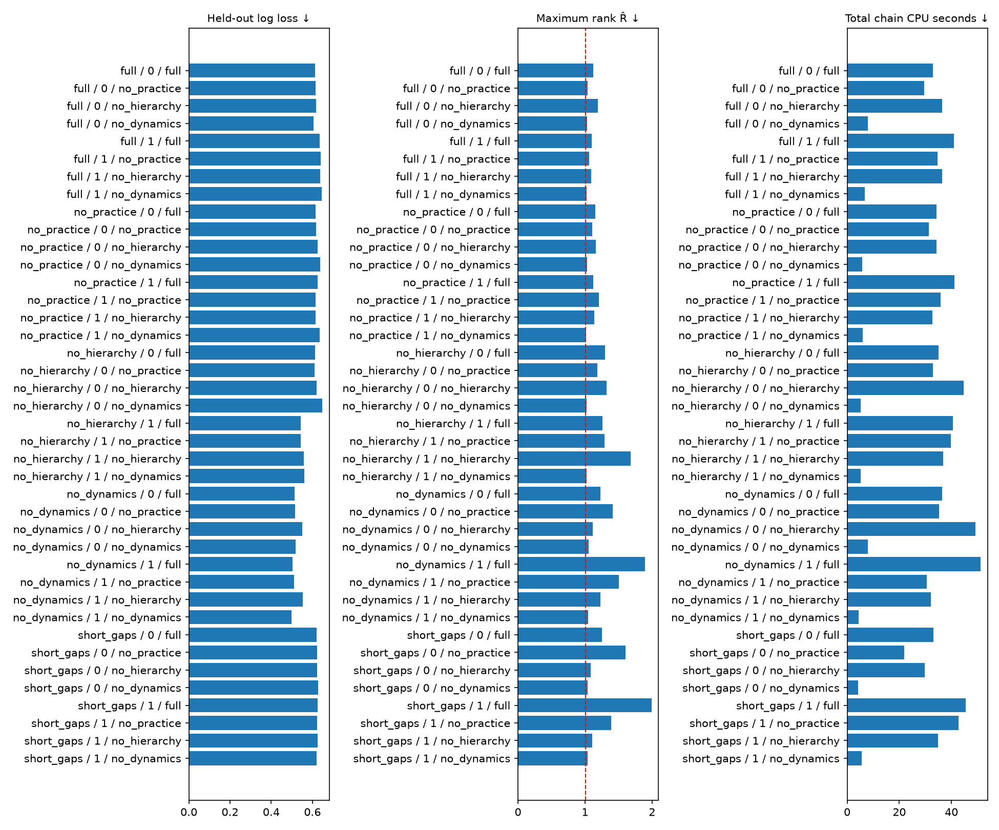

# Bayesian dynamic latent-state model: diagnostics and ablations

Run `task3-study`. Source: **synthetic**. 4 independent chains, 2400 iterations each; 1200 discarded warmup; no thinning.

## Scope and model

This study targets `AnkiFirstRun/dynamic_retention_model_optimised.py`, the pure NumPy time-aware OU model, not the event-indexed AR(1) model used by the original recall demo. The optimized-named file actually contains the pre-Numba implementation; it is reused directly for FFBS, priors and collapsed MH.

`mu = b0 + alpha_user + beta_item + gamma_user * previous_outcome`; `rate = lambda * exp(-kappa * log(1 + previous_successes))`; `phi = exp(-rate * gap_days)`; `q = sigma2 * (1 - phi²)/(2 * rate)`. The first state has variance 1. A Bernoulli-logistic observation measures the latent state. This is mean reversion on the logit scale, not a guarantee of monotonically decreasing recall with time.

Full has all components. No-practice fixes kappa=0; no-hierarchy fixes ability/item effects to zero and uses one population practice slope; no-dynamics is hierarchical lagged logistic regression with the same effect priors, removing state persistence and diffusion (and hence decay parameters). The last contrast removes the entire dynamics block; it cannot isolate persistence from diffusion.

Priors are inherited: b0 and g0 N(0,100); group effects Gaussian with inverse-gamma(2,1) variances; diffusion inverse-gamma(2,0.5); log lambda N(log(0.05),1.5²), restricted to [1e-4,20]; kappa N(0,1), restricted to [-3,3]. The harness uses the reference `polyagamma` package instead of the repository's truncated-series approximation. This is a deliberate sampler change, so these timings and diagnostics are not a reproduction of an earlier unrecorded run.

## Protocol and diagnostic gate

Each chain has its own seed and dispersed initial lambda (0.005, 0.05, 0.5, 2), diffusion (0.05, 0.2, 1, 3), kappa (-1, 0, 0.5, 1.5) and effect values. MH proposal adaptation stops at warmup. All retained draws enter diagnostics; prediction uses at most 200 evenly spaced draws per chain, with equal weight across chains. Warmup traces are retained separately. Lambda proposal acceptance and kappa sweep-move fractions are in chain-metadata.json; the latter is not an acceptance rate.

Rank-normalized folded split R̂ < 1.01 and both bulk/tail ESS ≥ 100 × chain count (400 here) are required for every monitored scalar. Nonfinite diagnostics fail the gate. Diagnostics include all effects, learned scales, terminal latent states, and centered effect contrasts, not just decay parameters. Fixed ablated parameters are excluded. Passing does not prove convergence; failing blocks trustworthy posterior interpretation. The old within-single-chain split R̂ is not used. See [Stan diagnostics](https://mc-stan.org/learn-stan/diagnostics-warnings.html) and [ArviZ rank R̂](https://python.arviz.org/en/v0.23.4/api/generated/arviz.rhat.html).

Each user/item sequence has a chronological held-out suffix. Every variant sees identical training and test events. Prediction is prequential: an outcome is used only after its own prediction, to update the state and practice count before later predictions. Dynamic prediction inherits the branch's logistic-normal approximation and PG-mean filtering; it is approximate rather than an exact held-out Bayesian filter. Log loss, Brier score, MAE, AUC and calibration bias are reported. No held-out score selects hyperparameters.

Fit cost is summed process CPU across chains (ESS/sec uses this denominator), with summed per-chain elapsed time also reported. Parallel job wall time is recorded separately and includes analysis/plotting overhead. Prediction CPU is separate. These costs are machine-specific.

## Results

| Scenario / replicate | Variant | Log loss | Brier | AUC | Max R̂ | Min bulk ESS | Min tail ESS | CPU s | Gate |
|---|---|---:|---:|---:|---:|---:|---:|---:|---|
| full / 0 | full | 0.6137 | 0.2124 | 0.644 | 1.125 | 27.6 | 70.3 | 32.8 | FAIL |
| full / 0 | no_practice | 0.6150 | 0.2129 | 0.634 | 1.040 | 72.2 | 119.6 | 29.6 | FAIL |
| full / 0 | no_hierarchy | 0.6185 | 0.2144 | 0.631 | 1.192 | 15.2 | 34.5 | 36.5 | FAIL |
| full / 0 | no_dynamics | 0.6056 | 0.2080 | 0.661 | 1.031 | 132.5 | 202.9 | 7.9 | FAIL |
| full / 1 | full | 0.6358 | 0.2227 | 0.709 | 1.099 | 36.2 | 87.5 | 40.9 | FAIL |
| full / 1 | no_practice | 0.6401 | 0.2246 | 0.709 | 1.065 | 57.6 | 128.3 | 34.6 | FAIL |
| full / 1 | no_hierarchy | 0.6386 | 0.2236 | 0.708 | 1.090 | 44.8 | 133.6 | 36.4 | FAIL |
| full / 1 | no_dynamics | 0.6443 | 0.2270 | 0.671 | 1.021 | 153.5 | 151.5 | 6.7 | FAIL |
| no_practice / 0 | full | 0.6164 | 0.2132 | 0.677 | 1.151 | 20.5 | 72.0 | 34.2 | FAIL |
| no_practice / 0 | no_practice | 0.6185 | 0.2142 | 0.675 | 1.111 | 39.7 | 70.7 | 31.3 | FAIL |
| no_practice / 0 | no_hierarchy | 0.6251 | 0.2171 | 0.656 | 1.159 | 19.8 | 28.5 | 34.3 | FAIL |
| no_practice / 0 | no_dynamics | 0.6378 | 0.2237 | 0.629 | 1.030 | 108.5 | 53.8 | 5.7 | FAIL |
| no_practice / 1 | full | 0.6263 | 0.2174 | 0.609 | 1.124 | 25.6 | 43.6 | 41.2 | FAIL |
| no_practice / 1 | no_practice | 0.6163 | 0.2129 | 0.635 | 1.205 | 17.8 | 22.1 | 35.8 | FAIL |
| no_practice / 1 | no_hierarchy | 0.6142 | 0.2118 | 0.661 | 1.139 | 24.2 | 113.7 | 32.6 | FAIL |
| no_practice / 1 | no_dynamics | 0.6343 | 0.2204 | 0.594 | 1.020 | 127.2 | 142.6 | 6.0 | FAIL |
| no_hierarchy / 0 | full | 0.6121 | 0.2113 | 0.752 | 1.298 | 11.4 | 13.6 | 35.0 | FAIL |
| no_hierarchy / 0 | no_practice | 0.6095 | 0.2101 | 0.753 | 1.184 | 15.9 | 57.0 | 32.9 | FAIL |
| no_hierarchy / 0 | no_hierarchy | 0.6211 | 0.2152 | 0.749 | 1.320 | 9.9 | 22.9 | 44.6 | FAIL |
| no_hierarchy / 0 | no_dynamics | 0.6488 | 0.2285 | 0.679 | 1.024 | 154.3 | 277.4 | 5.2 | FAIL |
| no_hierarchy / 1 | full | 0.5439 | 0.1806 | 0.748 | 1.260 | 12.9 | 24.1 | 40.5 | FAIL |
| no_hierarchy / 1 | no_practice | 0.5438 | 0.1806 | 0.747 | 1.292 | 12.0 | 44.1 | 39.8 | FAIL |
| no_hierarchy / 1 | no_hierarchy | 0.5586 | 0.1867 | 0.742 | 1.677 | 6.6 | 21.6 | 36.9 | FAIL |
| no_hierarchy / 1 | no_dynamics | 0.5615 | 0.1882 | 0.726 | 1.025 | 121.4 | 192.1 | 5.1 | FAIL |
| no_dynamics / 0 | full | 0.5138 | 0.1694 | 0.826 | 1.234 | 14.7 | 21.4 | 36.5 | FAIL |
| no_dynamics / 0 | no_practice | 0.5151 | 0.1697 | 0.823 | 1.414 | 8.7 | 13.3 | 35.4 | FAIL |
| no_dynamics / 0 | no_hierarchy | 0.5510 | 0.1850 | 0.772 | 1.117 | 28.5 | 48.6 | 49.2 | FAIL |
| no_dynamics / 0 | no_dynamics | 0.5184 | 0.1712 | 0.823 | 1.057 | 79.4 | 213.3 | 7.9 | FAIL |
| no_dynamics / 1 | full | 0.5036 | 0.1664 | 0.763 | 1.896 | 5.9 | 26.8 | 51.3 | FAIL |
| no_dynamics / 1 | no_practice | 0.5116 | 0.1698 | 0.757 | 1.508 | 7.6 | 29.3 | 30.5 | FAIL |
| no_dynamics / 1 | no_hierarchy | 0.5539 | 0.1846 | 0.655 | 1.228 | 13.7 | 23.0 | 32.0 | FAIL |
| no_dynamics / 1 | no_dynamics | 0.4978 | 0.1640 | 0.774 | 1.048 | 121.3 | 232.4 | 4.4 | FAIL |
| short_gaps / 0 | full | 0.6198 | 0.2163 | 0.687 | 1.249 | 14.1 | 25.3 | 33.1 | FAIL |
| short_gaps / 0 | no_practice | 0.6216 | 0.2171 | 0.689 | 1.604 | 6.7 | 18.9 | 21.9 | FAIL |
| short_gaps / 0 | no_hierarchy | 0.6236 | 0.2179 | 0.679 | 1.087 | 35.4 | 97.0 | 29.7 | FAIL |
| short_gaps / 0 | no_dynamics | 0.6277 | 0.2197 | 0.700 | 1.036 | 98.4 | 150.8 | 4.1 | FAIL |
| short_gaps / 1 | full | 0.6250 | 0.2165 | 0.714 | 1.994 | 5.5 | 13.0 | 45.5 | FAIL |
| short_gaps / 1 | no_practice | 0.6238 | 0.2161 | 0.713 | 1.388 | 9.2 | 35.3 | 42.7 | FAIL |
| short_gaps / 1 | no_hierarchy | 0.6263 | 0.2173 | 0.711 | 1.110 | 28.7 | 29.0 | 34.9 | FAIL |
| short_gaps / 1 | no_dynamics | 0.6193 | 0.2153 | 0.717 | 1.039 | 74.7 | 69.9 | 5.5 | FAIL |

## Controlled component contrasts

Delta = ablated log loss − full log loss: positive favors the full model. Intervals are paired user-cluster bootstrap percentiles (1,000 resamples). With few users they are unstable and do not include MCMC uncertainty or correct for multiple comparisons. Results remain exploratory when either model fails diagnostics.

| Scenario / replicate | Ablation | Delta log loss | 95% cluster interval | Interpretation |
|---|---|---:|---|---|
| full / 0 | no_practice | 0.0013 | [-0.0027, 0.0058] | Convergence unresolved |
| full / 0 | no_hierarchy | 0.0049 | [-0.0187, 0.0374] | Convergence unresolved |
| full / 0 | no_dynamics | -0.0081 | [-0.0343, 0.0158] | Convergence unresolved |
| full / 1 | no_practice | 0.0044 | [-0.0001, 0.0089] | Convergence unresolved |
| full / 1 | no_hierarchy | 0.0029 | [-0.0070, 0.0114] | Convergence unresolved |
| full / 1 | no_dynamics | 0.0086 | [-0.0176, 0.0347] | Convergence unresolved |
| no_practice / 0 | no_practice | 0.0021 | [0.0012, 0.0032] | Convergence unresolved |
| no_practice / 0 | no_hierarchy | 0.0087 | [-0.0066, 0.0241] | Convergence unresolved |
| no_practice / 0 | no_dynamics | 0.0214 | [-0.0157, 0.0540] | Convergence unresolved |
| no_practice / 1 | no_practice | -0.0100 | [-0.0140, -0.0052] | Convergence unresolved |
| no_practice / 1 | no_hierarchy | -0.0121 | [-0.0285, -0.0002] | Convergence unresolved |
| no_practice / 1 | no_dynamics | 0.0080 | [-0.0188, 0.0394] | Convergence unresolved |
| no_hierarchy / 0 | no_practice | -0.0027 | [-0.0040, -0.0015] | Convergence unresolved |
| no_hierarchy / 0 | no_hierarchy | 0.0090 | [-0.0006, 0.0246] | Convergence unresolved |
| no_hierarchy / 0 | no_dynamics | 0.0367 | [0.0302, 0.0431] | Convergence unresolved |
| no_hierarchy / 1 | no_practice | -0.0001 | [-0.0027, 0.0037] | Convergence unresolved |
| no_hierarchy / 1 | no_hierarchy | 0.0148 | [0.0002, 0.0293] | Convergence unresolved |
| no_hierarchy / 1 | no_dynamics | 0.0177 | [0.0051, 0.0304] | Convergence unresolved |
| no_dynamics / 0 | no_practice | 0.0014 | [-0.0005, 0.0033] | Convergence unresolved |
| no_dynamics / 0 | no_hierarchy | 0.0372 | [0.0301, 0.0452] | Convergence unresolved |
| no_dynamics / 0 | no_dynamics | 0.0047 | [-0.0014, 0.0105] | Convergence unresolved |
| no_dynamics / 1 | no_practice | 0.0079 | [-0.0043, 0.0260] | Convergence unresolved |
| no_dynamics / 1 | no_hierarchy | 0.0503 | [0.0187, 0.0852] | Convergence unresolved |
| no_dynamics / 1 | no_dynamics | -0.0058 | [-0.0135, 0.0014] | Convergence unresolved |
| short_gaps / 0 | no_practice | 0.0018 | [0.0002, 0.0035] | Convergence unresolved |
| short_gaps / 0 | no_hierarchy | 0.0038 | [0.0010, 0.0067] | Convergence unresolved |
| short_gaps / 0 | no_dynamics | 0.0080 | [-0.0104, 0.0370] | Convergence unresolved |
| short_gaps / 1 | no_practice | -0.0011 | [-0.0026, -0.0004] | Convergence unresolved |
| short_gaps / 1 | no_hierarchy | 0.0013 | [-0.0168, 0.0155] | Convergence unresolved |
| short_gaps / 1 | no_dynamics | -0.0057 | [-0.0427, 0.0264] | Convergence unresolved |

## Recovery and identifiability

Known truth is available. Matched generating/fitted variants yield 234 parameter intervals; 106 pass their parameter diagnostic gate; 104 of those contain the truth. These are dependent, few-replicate descriptive counts, not calibrated coverage or simulation-based calibration.

Recovery.csv contains truth, posterior mean, signed error, squared error, 95% interval, coverage and a parameter-level gate for all recoverable parameters. Recovery-summary.csv gives replicate bias, RMSE and coverage with separate convergence counts. Misspecified variants are flagged and must not be interpreted as parameter recovery under their own DGP.

The likelihood depends on b0+alpha+beta, so additive shifts in b0 and group effects are not separately likelihood-identified; proper priors regularize these directions without creating data information. Centered alpha/beta contrasts and population_level are reported alongside raw coefficients. Centering is post-processing, not a sampler reparameterization. User-nested item designs worsen ability/item separation; this cannot be fixed just by longer chains.

Lambda and kappa share log(rate)=log(lambda)−kappa×log(1+past_successes). A narrow practice-count range makes them hard to separate. Diffusion and decay both control transition variance, giving additional posterior dependence. Pair plots and correlations quantify these sample-specific ridges; they do not prove structural identifiability.

## Conclusions and next investigations

0 of 40 fitted variants pass the full diagnostic gate. No component is declared empirically justified from predictive point estimates alone. A component requires a converged controlled contrast, a credible predictive improvement, and replication on representative learner data. Synthetic matched recovery tests the implementation under assumed ground truth; it does not establish real-world usefulness.

Inspect chains for drift, poor rank overlap and long autocorrelation first. Extend warmup and retained draws using saved settings. If diagnostics remain poor, investigate blocked population/effect updates, non-centered random effects, and jointly proposing decay/diffusion; these are recommendations, not implemented remedies. Use short-gap scenarios and multiple practice ranges to probe weak identification. Run more independent synthetic datasets and a prior-drawn SBC study before claiming calibrated inference.

No previously observed ESS/R̂ values are reconstructed without their original chain files and exact configuration. This run is new evidence. See provenance.json for revision, source hashes, dependency versions, seed and dataset hash; config.json and dataset files allow reruns. NPZ files preserve chain/draw axes and all retained parameters.

## Artifacts

Per-fit trace/ACF, pooled rank and posterior-pair plots are alongside CSV diagnostics, predictions, draws, recovery summaries and chain metadata. Report status is never changed to converged just because computation finished.
