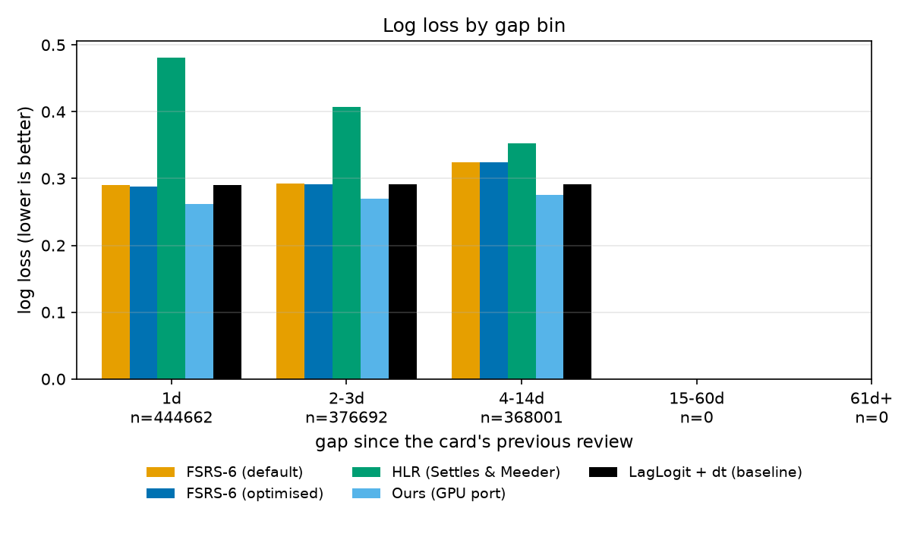
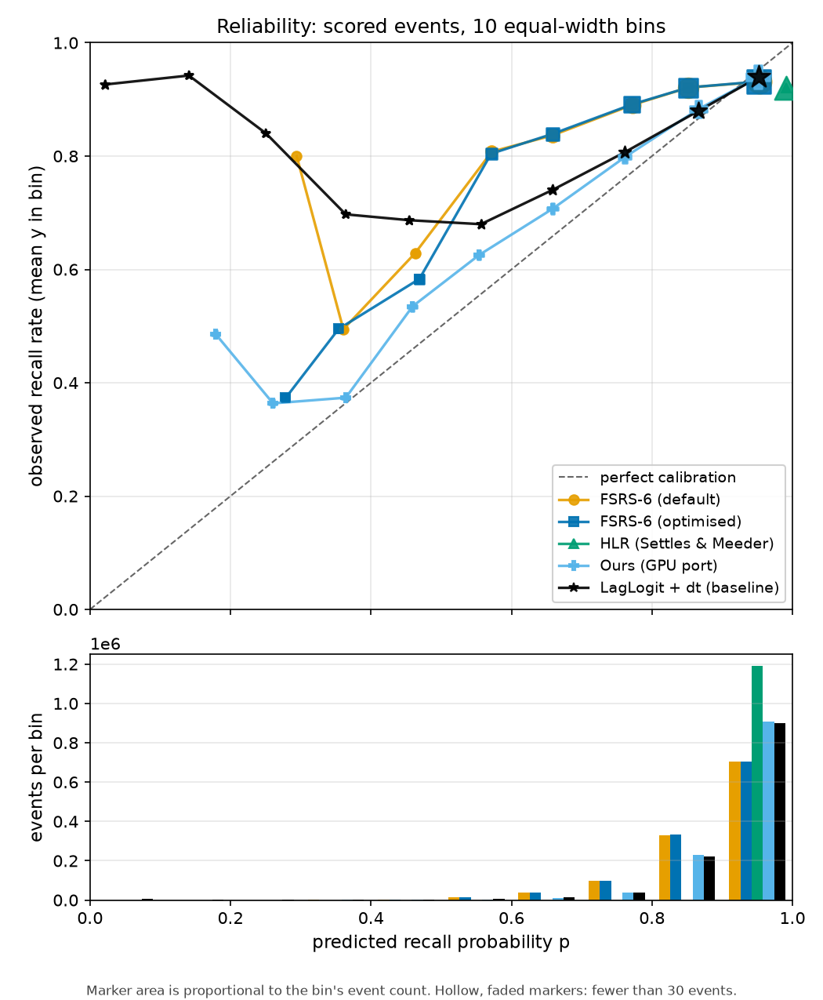

# Results: duolingo_full (Duolingo dataset)

## Data

- Dataset: Duolingo learning traces (Settles & Meeder 2016), min_user_rows=1
- Users: 115222, cards: 5861629, events: 12854226 (6468512 train, 6385714 test)
- Scored events: 1189355, recall rate 0.920
- FSRS-6 optimised fallback users (defaults kept): 115110
- Users with zero train rows: 64254
- Git commit: ea51d426a5868824b78a38347732ada9bd8d562b (dirty: True)
- Config: n_users=0, max_cards=1000000000, seed=0, iters=2000, burn=1000

Per-model timings (seconds):

| Model | Fit | Predict |
|---|---|---|
| FSRS-6 (default) | 2.836 | 2528.601 |
| FSRS-6 (optimised) | 687.517 | 2520.613 |
| HLR (Settles & Meeder) | 234.849 | 8.949 |
| Ours (GPU port) | 2597.887 | 1943.899 |
| LagLogit + dt (baseline) | 894.094 | 149.087 |

## Overall

| Model | n | Recall | Log loss | Brier | AUC | ECE | RMSE (bins) | Mean bias |
|---|---|---|---|---|---|---|---|---|
| FSRS-6 (default) | 1189355 | 0.920 | 0.302 | 0.078 | 0.566 | 0.051 | 0.070 | -0.025 |
| FSRS-6 (optimised) | 1189355 | 0.920 | 0.300 | 0.078 | 0.570 | 0.050 | 0.070 | -0.026 |
| HLR (Settles & Meeder) | 1189355 | 0.920 | 0.418 | 0.079 | 0.521 | 0.072 | 0.072 | 0.072 |
| Ours (GPU port) | 1189355 | 0.920 | **0.268** | **0.071** | **0.656** | **0.014** | **0.017** | 0.004 |
| LagLogit + dt (baseline) | 1189355 | 0.920 | 0.291 | 0.076 | 0.653 | 0.020 | 0.068 | **-0.001** |

Best value per column in bold. Mean bias is closest to zero.

## Gap bins (days since the card's previous review)

### 1d (n = 444662)

| Model | Recall | Log loss | Brier | AUC | ECE | Mean bias |
|---|---|---|---|---|---|---|
| FSRS-6 (default) | 0.922 | 0.290 | 0.072 | 0.580 | 0.031 | 0.021 |
| FSRS-6 (optimised) | 0.922 | 0.288 | 0.072 | 0.584 | 0.031 | 0.020 |
| HLR (Settles & Meeder) | 0.922 | 0.481 | 0.077 | 0.543 | 0.075 | 0.075 |
| Ours (GPU port) | 0.922 | **0.261** | **0.069** | **0.660** | **0.013** | 0.002 |
| LagLogit + dt (baseline) | 0.922 | 0.290 | 0.075 | 0.652 | 0.021 | **0.001** |

### 2-3d (n = 376692)

| Model | Recall | Log loss | Brier | AUC | ECE | Mean bias |
|---|---|---|---|---|---|---|
| FSRS-6 (default) | 0.919 | 0.293 | 0.076 | 0.564 | 0.032 | -0.018 |
| FSRS-6 (optimised) | 0.919 | 0.292 | 0.076 | 0.567 | 0.031 | -0.019 |
| HLR (Settles & Meeder) | 0.919 | 0.407 | 0.079 | 0.530 | 0.074 | 0.074 |
| Ours (GPU port) | 0.919 | **0.270** | **0.072** | **0.652** | **0.014** | 0.004 |
| LagLogit + dt (baseline) | 0.919 | 0.291 | 0.076 | 0.650 | 0.019 | **-0.000** |

### 4-14d (n = 368001)

| Model | Recall | Log loss | Brier | AUC | ECE | Mean bias |
|---|---|---|---|---|---|---|
| FSRS-6 (default) | 0.917 | 0.325 | 0.087 | 0.554 | 0.095 | -0.088 |
| FSRS-6 (optimised) | 0.917 | 0.324 | 0.087 | 0.556 | 0.094 | -0.088 |
| HLR (Settles & Meeder) | 0.917 | 0.353 | 0.080 | 0.522 | 0.065 | 0.065 |
| Ours (GPU port) | 0.917 | **0.275** | **0.074** | 0.655 | **0.016** | 0.006 |
| LagLogit + dt (baseline) | 0.917 | 0.292 | 0.077 | **0.658** | 0.020 | **-0.005** |

### 15-60d

No scored events in this bin.

### 61d+

No scored events in this bin.

## Paired differences (model minus reference), 95% user-cluster bootstrap

Bootstrap: 1000 user-cluster resamples with replacement, seed 0, 95% percentile CI, diff = model minus reference.

| Comparison | Metric | Diff | 95% CI |
|---|---|---|---|
| FSRS-6 (default) - FSRS-6 (optimised) | log_loss | 0.002 | [0.001, 0.002] * |
| FSRS-6 (default) - FSRS-6 (optimised) | brier | 0.000 | [0.000, 0.000] * |
| FSRS-6 (default) - FSRS-6 (optimised) | auc | -0.003 | [-0.005, -0.002] * |
| FSRS-6 (default) - FSRS-6 (optimised) | ece | 0.000 | [0.000, 0.001] * |
| HLR (Settles & Meeder) - FSRS-6 (optimised) | log_loss | 0.118 | [0.112, 0.124] * |
| HLR (Settles & Meeder) - FSRS-6 (optimised) | brier | 0.001 | [0.000, 0.002] * |
| HLR (Settles & Meeder) - FSRS-6 (optimised) | auc | -0.049 | [-0.055, -0.043] * |
| HLR (Settles & Meeder) - FSRS-6 (optimised) | ece | 0.021 | [0.019, 0.023] * |
| Ours (GPU port) - FSRS-6 (optimised) | log_loss | -0.032 | [-0.033, -0.031] * |
| Ours (GPU port) - FSRS-6 (optimised) | brier | -0.006 | [-0.007, -0.006] * |
| Ours (GPU port) - FSRS-6 (optimised) | auc | 0.087 | [0.083, 0.091] * |
| Ours (GPU port) - FSRS-6 (optimised) | ece | -0.036 | [-0.037, -0.035] * |
| LagLogit + dt (baseline) - FSRS-6 (optimised) | log_loss | -0.009 | [-0.012, -0.007] * |
| LagLogit + dt (baseline) - FSRS-6 (optimised) | brier | -0.002 | [-0.002, -0.001] * |
| LagLogit + dt (baseline) - FSRS-6 (optimised) | auc | 0.084 | [0.080, 0.088] * |
| LagLogit + dt (baseline) - FSRS-6 (optimised) | ece | -0.030 | [-0.031, -0.029] * |

* CI excludes 0.

## Per-user wins on log loss

| Comparison | Users | Users with lower log loss | Share |
|---|---|---|---|
| FSRS-6 (default) vs FSRS-6 (optimised) | 41223 | 10 | 0.000 |
| HLR (Settles & Meeder) vs FSRS-6 (optimised) | 41223 | 23766 | 0.577 |
| Ours (GPU port) vs FSRS-6 (optimised) | 41223 | 30511 | 0.740 |
| LagLogit + dt (baseline) vs FSRS-6 (optimised) | 41223 | 29525 | 0.716 |

Share = users with lower log loss for the model / users with a finite log loss for both.

## MCMC diagnostics

R-hat here is split-R-hat computed on a single chain (no between-chain comparison). ESS is the effective sample size of the kept draws.

### Ours (GPU port)

Kept draws: 100; lambda Metropolis-Hastings acceptance: mean after burn-in 0.152, mean over all sweeps 0.160. lambda acceptance: mean over all Gibbs sweeps (mh_acc_rate) and over sweeps after burn-in (mh_acc_rate_mean_postburn).

| Param | Mean | 95% interval | ESS | R-hat |
|---|---|---|---|---|
| lam | 1.034 | [0.956, 1.136] | 3 | 2.481 |
| sigma2 | 0.603 | [0.571, 0.648] | 3 | 2.449 |
| b0 | 3.673 | [3.649, 3.686] | 4 | 1.771 |
| g0 | -0.184 | [-0.206, -0.171] | 10 | 1.157 |
| tau2_alpha | 1.341 | [1.314, 1.363] | 20 | 1.012 |
| tau2_beta | 0.205 | [0.198, 0.218] | 3 | 2.151 |
| tau2_gamma | 0.340 | [0.302, 0.373] | 3 | 2.641 |

## Figures

